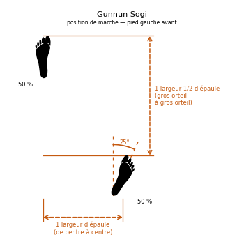

# Gunnun Sogi

> 🔊 **Prononciation :** [걷는 서기](../audio/Techniques/Gunnun-Sogi.m4a)

La **Gunnun Sogi** ([걷는 서기](../audio/grammaire/Gunnun-Sogi.m4a)) est la position de marche du TaeKwon-Do ITF. C'est la position d'attaque et de défense vers l'avant par excellence, et l'une des premières apprises.

Elle se traduit par : **Position de marche** (*Walking stance*).

---

## 1. Décomposition de la terminologie coréenne

| Terme | Hangeul | Traduction | Rôle dans la technique |
| --- | --- | --- | --- |
| **Gunnun** | [걷는](../audio/termes/gunnun.m4a) | Qui marche | La position reproduit un pas de marche allongé. |
| **Sogi** | [서기](../audio/termes/sogi.m4a) | Position / posture | Posture générale du corps et ancrage des jambes. |

---

## 2. Exécution et principes biomécaniques

1. **Les dimensions :**
    * **Longueur :** une largeur d'épaules et demie, mesurée entre les gros orteils des deux pieds.
    * **Largeur :** une largeur d'épaule, mesurée de centre à centre des pieds.
2. **L'orientation des pieds :**
    * **Pied avant :** pointe droit devant.
    * **Pied arrière :** ouvert à **25° vers l'extérieur**. Plus ouvert, il fragilise le genou face à une attaque par l'arrière.
3. **La flexion des jambes :**
    * **Jambe avant :** fléchie jusqu'à ce que la rotule soit à l'aplomb du talon.
    * **Jambe arrière :** complètement tendue.
4. **Le poids :** réparti à parts égales, **50 / 50**.
5. **La musculature :** les muscles des pieds se tendent comme s'ils tiraient l'un vers l'autre, pour sceller l'ancrage au sol.
6. **Le buste :** de face (*Jeongmyon*) le plus souvent ; à mi-profil (*Ban Mom*) pour certains blocages.

---

## 3. Applications et avantages martiaux

* **Puissance vers l'avant :** la jambe arrière tendue transmet la poussée du sol à la technique.
* **Stabilité dans les deux sens :** la position est forte vers l'avant comme vers l'arrière.
* **Présence dans les formes :** elle apparaît dès *Chon-Ji* et dans presque toutes les formes.

> **Toi-Gye Tul, mouvement 20 :** *Étendre les deux mains vers le haut comme pour saisir la tête de l'adversaire tout en formant une position de marche gauche vers D, en glissant le pied gauche vers D.* Le nom du mouvement ne donne que la position : les mains saisissent la tête, pour l'attirer vers le coup de genou du mouvement 21 ([Moorup Ollyo Chagi](../chagi/moorup-ollyo-chagi.md)).

---

## 4. Erreurs fréquentes à éviter

* **Position trop longue :** elle ralentit le déplacement et fragilise la posture contre une attaque de côté.
* **Pieds sur une même ligne :** sans largeur d'épaule, la position perd toute stabilité latérale.
* **Pied arrière trop ouvert :** au-delà de 25°, le genou arrière est exposé.
* **Genou avant trop ou pas assez fléchi :** la rotule doit être à l'aplomb du talon.
* **Talon arrière décollé :** la jambe arrière doit rester tendue, le talon au sol.

Voir aussi : [16.9 Position de marche (Gunnun Sogi)](../Theorie/manuel/partie-4-positions-sogi/16-les-21-positions-en-detail.md#169-position-de-marche-gunnun-sogi) dans le manuel.
