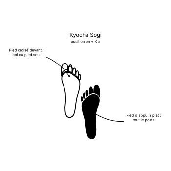

# Kyocha Sogi

> 🔊 **Prononciation :** [교차 서기](../audio/Techniques/Kyocha-Sogi.m4a)

Le **Kyocha Sogi** ([교차 서기](../audio/Techniques/Kyocha-Sogi.m4a)) est la **posture croisée** (*X-stance*) en TaeKwon-Do ITF.

C'est une posture dynamique, hautement mobile et compacte, principalement utilisée pour effectuer des transitions rapides, des esquives latérales, des sauts ou des changements d'axe brusques tout en maintenant une capacité de blocage ou de frappe immédiate.

---

## 1. Caractéristiques techniques et géométrie (*Jook Bang*)

| Caractéristique | Norme technique ITF |
| --- | --- |
| **Pied avant (Jambe porteuse)** | Posé à plat au sol, orienté généralement vers la direction du mouvement ou du blocage. |
| **Pied arrière** | Croisé derrière (ou parfois devant) le pied avant, reposant uniquement sur le bol du pied (**Ap Chook**), le talon nettement décollé du sol. |
| **Répartition du poids** | **Quasi-totalité du poids du corps (environ 90 à 95%) sur la jambe porteuse** (posée à plat). La jambe croisée ne sert que de tuteur et d'appui d'équilibrage léger. |
| **Position des genoux** | Les deux genoux sont fléchis et serrés l'un contre l'autre, le creux du genou arrière venant se caler contre l'arrière du genou avant. |
| **Hauteur** | Posture semi-basse et très ancrée grâce à la flexion marquée des jambes. |

---

## 2. Décomposition de l'exécution

1. **Le Croisement :** Une jambe passe devant ou derrière l'autre lors d'un pas, d'une réception de saut ou d'un pivot.
2. **L'Ancrage du pied porteur :** Le pied de la jambe principale se pose fermement à plat pour absorber la chute de masse (*Sine Wave*).
3. **Le Verrouillage du pied d'appui :** L'autre pied se cale immédiatement sur la demi-pointe (*Ap Chook*), le talon levé.
4. **La Compression des genoux :** Fléchir les deux genoux simultanément pour sceller le centre de gravité et verrouiller le bas du corps au moment précis où le blocage ou la frappe s'exécute.

---

## 3. Distinctions importantes : *Baro* vs *Bandae* en Kyocha Sogi

En TaeKwon-Do ITF, la dénomination d'une technique exécutée en *Kyocha Sogi* dépend de la jambe porteuse (celle posée à plat qui supporte le poids) :

* **Technique Directe (*Baro*) :** La frappe ou le blocage est exécuté avec le bras situé **du même côté que la jambe porteuse** (ex: jambe droite à plat devant + bras droit qui bloque/frappe).
* **Technique Inversée (*Bandae*) :** La frappe ou le blocage est exécuté avec le bras situé **du côté de la jambe arrière/d'appui** (ex: jambe droite à plat devant + bras gauche qui bloque/frappe).

---

## 4. Intérêt tactique et Application dans les patrons (*Tul*)

> **Mobilité, absorption et changement de direction instantané :**
> 1. **Réception de saut et absorption :** C'est la posture de réception idéale après un saut pour absorber l'impact au sol grâce à la flexion double des genoux.
> 2. **Esquive et changement d'axe :** Elle permet de se désaxer rapidement d'une ligne d'attaque adverse sans perdre son équilibre ni réduire sa capacité de riposte.
> 3. **Ressort explosif :** La position fléchie des genoux emmagasine de l'énergie élastique, permettant de jaillir immédiatement dans une autre direction ou d'enchaîner un coup de pied (*Chagi*).
> 4. **Présence dans les patrons (*Tul*) :** On retrouve *Kyocha Sogi* dans de nombreux patrons ITF, notamment dans **Go-Dang Tul / Juche Tul**, **Po-Eun Tul**, **Ge-Baek Tul** et **Yoo-Sin Tul**.

---

## 5. Erreurs fréquentes à éviter

* **Poser le talon arrière à plat :** C'est l'erreur la plus courante. Poser le talon du pied arrière détruit toute la flexibilité, bloque le bassin et empêche le transfert de masse.
* **Mettre du poids sur la jambe arrière :** Charger la jambe croisée au lieu de garder 90% du poids ancré sur la jambe porteuse avant.
* **Jambes tendues ou genoux écartés :** Garder les jambes raides ou laisser un espace entre les genoux, ce qui rend la posture extrêmement instable.
* **Pieds trop éloignés :** Trop écarter les pieds latéralement lors du croisement au lieu de caler le bol du pied arrière juste à côté/derrière le talon avant.
