# Les positions (Sogi)

Fiche cotée de chaque position dans la [partie IV du manuel](../manuel/partie-4-positions-sogi/README.md). Dans le nom d'une technique, *Sogi* se raccourcit en *So* : *Gunnun So Kaunde Jirugi*.

| Terme | Hangul | Traduction | Définition | Schéma |
| :--- | :--- | :--- | :--- | :---: |
| **Sogi** | [서기](../../audio/termes/서기.m4a) | Position | Littéralement « se tenir debout ». | — |
| **So** | [서](../../audio/termes/서.m4a) | Position (forme courte) | Placée en tête d'un nom de technique pour indiquer la position. | — |
| **Jase** | [자세](../../audio/termes/자세.m4a) | Posture | Attitude du corps, comme dans Kyong Ye Jase. | — |
| **Junbi Sogi** | [준비 서기](../../audio/grammaire/Junbi-Sogi.m4a) | Position d'attente | Position prise avant une forme ou un exercice ; plusieurs variantes. | [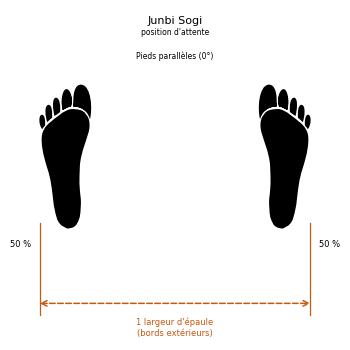](../../images/sogi/junbi-sogi.png) |
| **Charyo Sogi** | [차렷 서기](../../audio/grammaire/Charyo-Sogi.m4a) | Position à l'attention | Talons joints, pointes ouvertes à 45°. | [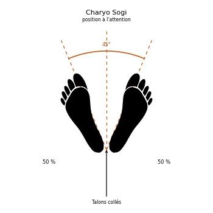](../../images/sogi/charyo-sogi.png) |
| **Moa Sogi** | [모아 서기](../../audio/grammaire/Moa-Sogi.m4a) | Position pieds joints | Pieds collés l'un contre l'autre. | [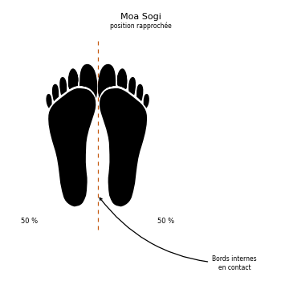](../../images/sogi/moa-sogi.png) |
| **Narani Sogi** | [나란히 서기](../../audio/grammaire/Narani-Sogi.m4a) | Position parallèle | Pieds parallèles écartés de la largeur des épaules. | [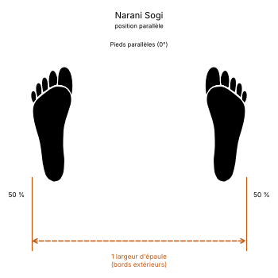](../../images/sogi/narani-sogi.png) |
| **Palja Sogi** | [팔자 서기](../../audio/grammaire/Palja-Sogi.m4a) | Position ouverte | Pieds en forme de 八 ; pointes vers l'extérieur (Bakat) ou l'intérieur (An). | [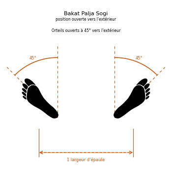](../../images/sogi/bakat-palja-sogi.png) [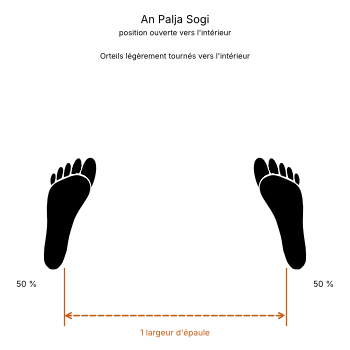](../../images/sogi/an-palja-sogi.png) |
| **Annun Sogi** | [앉은 서기](../../audio/grammaire/Annun-Sogi.m4a) | Position assise | Position du cavalier, jambes fléchies, poids également réparti. | [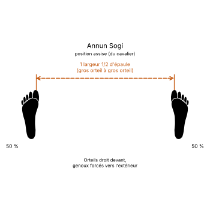](../../images/sogi/annun-sogi.png) |
| **Gunnun Sogi** | [걷는 서기](../../audio/grammaire/Gunnun-Sogi.m4a) | Position de marche | Position avant longue, genou avant fléchi au-dessus du talon. | [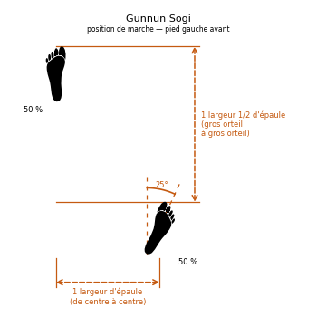](../../images/sogi/gunnun-sogi.png) |
| **Niunja Sogi** | [ㄴ자 서기](../../audio/grammaire/Niunja-Sogi.m4a) | Position en L | Pieds en forme de la lettre [ㄴ](../../audio/termes/ㄴ.m4a) ; 70 % du poids sur la jambe arrière. | [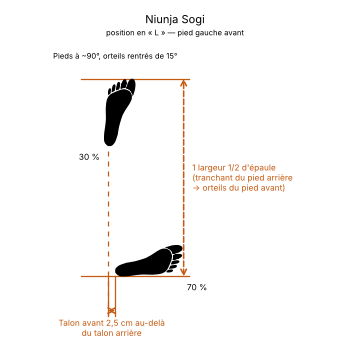](../../images/sogi/niunja-sogi.png) |
| **Gojung Sogi** | [고정 서기](../../audio/grammaire/Gojung-Sogi.m4a) | Position fixe | Proche de la position en L, poids réparti à parts égales. | [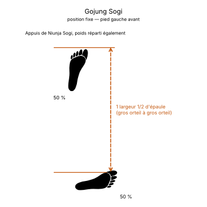](../../images/sogi/gojung-sogi.png) |
| **Dwitbal Sogi** | [뒷발 서기](../../audio/grammaire/Dwitbal-Sogi.m4a) | Position arrière rapprochée | Position courte, l'essentiel du poids sur la jambe arrière. | [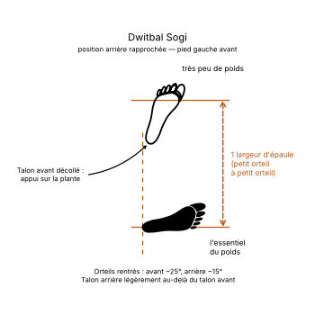](../../images/sogi/dwitbal-sogi.png) |
| **Kyocha Sogi** | [교차 서기](../../audio/grammaire/Kyocha-Sogi.m4a) | Position en X | Jambes croisées, souvent à la réception d'un saut. | [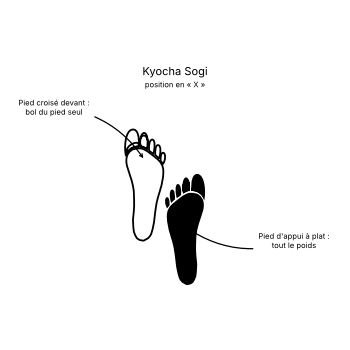](../../images/sogi/kyocha-sogi.png) |
| **Waebal Sogi** | [외발 서기](../../audio/grammaire/Waebal-Sogi.m4a) | Position sur une jambe | Équilibre sur un seul pied, l'autre posé contre le genou. | [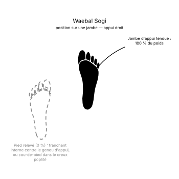](../../images/sogi/waebal-sogi.png) |
| **Guburyo Sogi** | [구부려 서기](../../audio/grammaire/Guburyo-Sogi.m4a) | Position fléchie | Sur une jambe fléchie, l'autre armée pour frapper. | [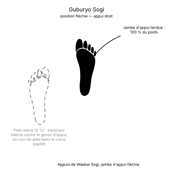](../../images/sogi/guburyo-sogi.png) |
| **Nachuo Sogi** | [낮추어 서기](../../audio/grammaire/Nachuo-Sogi.m4a) | Position basse | Position de marche allongée d'un pied. | [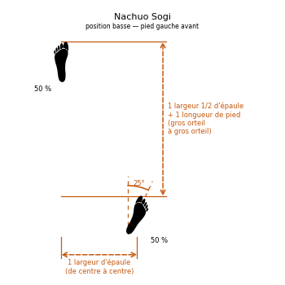](../../images/sogi/nachuo-sogi.png) |
| **Soojik Sogi** | [수직 서기](../../audio/grammaire/Soojik-Sogi.m4a) | Position verticale | Pieds sur une même ligne, 60 % du poids à l'arrière. | [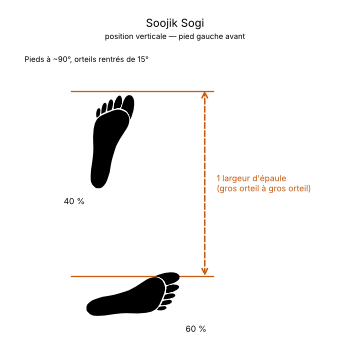](../../images/sogi/soojik-sogi.png) |
| **Sasun Sogi** | [사선 서기](../../audio/grammaire/Sasun-Sogi.m4a) | Position en diagonale | Pieds décalés en diagonale. | [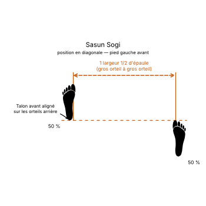](../../images/sogi/sasun-sogi.png) |
| **Oguryo Sogi** | [오구려 서기](../../audio/grammaire/Oguryo-Sogi.m4a) | Position accroupie | Variante de la position en diagonale, genoux forcés vers l'intérieur. | [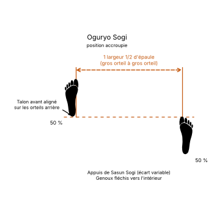](../../images/sogi/oguryo-sogi.png) |
