# 16. Les 21 positions en détail

Chaque fiche donne les dimensions, l'orientation des pieds, la répartition du poids et le schéma d'alignement coté. Les schémas sont générés par [scripts/generer-sogi.py](https://github.com/yvmori1/La-boite-outils-ITF/blob/main/scripts/generer-sogi.py) ; les longueurs y sont exprimées en largeurs d'épaule.

## 16.1 Position d'attente (Junbi Sogi)

* **Nomenclature coréenne :** *Junbi Sogi / [준비 서기](../../../audio/grammaire/Junbi-Sogi.m4a)*.
* **Largeur :** **Une largeur d'épaule** mesurée de l'extérieur des deux pieds.
* **Orientation :** Les pieds sont strictement parallèles, les orteils pointant vers l'avant (0°).
* **Poids :** Réparti à 50% sur le pied gauche, 50% sur le pied droit.
* **Usage :** Posture neutre de concentration permettant de se recentrer avant d'entamer les exercices fondamentaux et les formes.
* **Schéma d'alignement :**

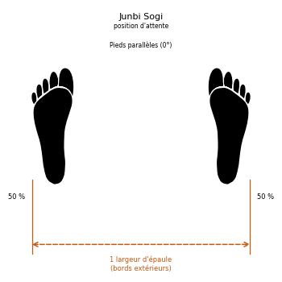

## 16.2 Position d'attente rapprochée (Moa Junbi Sogi)

* **Nomenclature coréenne :** *Moa Junbi Sogi / [모아 준비 서기](../../../audio/grammaire/Moa-Junbi-Sogi.m4a)*.
* **Largeur :** Pieds entièrement collés l'un contre l'autre (bords internes en contact).
* **Poids :** Réparti à 50% sur le pied gauche, 50% sur le pied droit.
* **Variantes de Garde (Mains) :**
    * **Type A :** Les poings fermés sont tenus haut devant le visage. La distance entre la racine du nez et les poings est d'environ **30 cm**.
    * **Type B :** Les poings sont placés devant le tronc. La distance entre les poings et le nombril est d'environ **15 cm**.
    * **Type C :** Les mains ouvertes sont placées bas devant l'abdomen. La distance entre les mains et l'abdomen est d'environ **10 cm**.
* **Schéma d'alignement :**

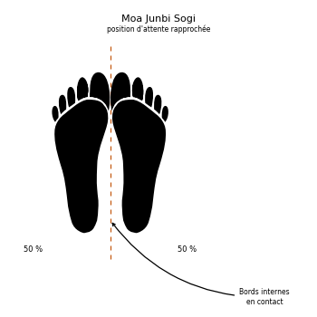

## 16.3 Position d'attente fléchie (Guburyo Junbi Sogi)

* **Nomenclature coréenne :** *Guburyo Junbi Sogi / [구부려 준비 서기](../../../audio/grammaire/Guburyo-Junbi-Sogi.m4a)*.
* **Exécution :** La jambe de support est fléchie, son pied pointant vers l'avant. L'autre pied est relevé et maintenu parallèle au sol à la hauteur du genou de soutien.
* **Poids :** 100% sur la jambe de support, 0% sur la jambe levée.
* **Variantes de Garde (Mains) :**
    * **Type A :** Posture préparatoire au coup de pied de côté (*Yop Chagi*). Les bras effectuent un double blocage des avant-bras (*Twin Forearm Block*).
    * **Type B :** Posture préparatoire au coup de pied arrière (*Dwit Chagi*). Distance d'environ **25 cm** entre les poings et les hanches, les coudes pliés à **30 degrés**.
* **Schéma d'alignement :**

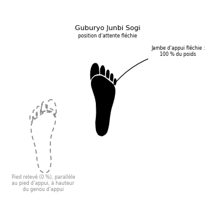

## 16.4 Position à l'attention (Charyo Sogi)

* **Nomenclature coréenne :** *Charyo Sogi / [차렷 서기](../../../audio/grammaire/Charyo-Sogi.m4a)*.
* **Largeur :** Talons collés, bords internes ouverts.
* **Orientation :** Les pieds forment un angle de **45 degrés**.
* **Posture :** Les poings sont fermés et placés légèrement le long du corps de chaque côté au naturel, les épaules inclinées et le regard fixé vers l'avant.
* **Usage :** Position prise avant et après le cours.
* **Schéma d'alignement :**

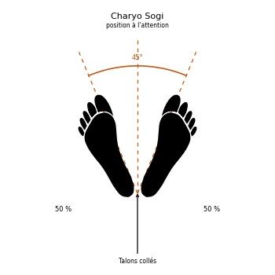

## 16.5 Position de salut (Kyong Ye Jase)

* **Nomenclature coréenne :** *Kyong Ye Jase / [경례 자세](../../../audio/grammaire/Kyong-Ye-Jase.m4a)*.
* **Exécution :** À partir de la position à l'attention (*Charyo Sogi*), on incline le corps de **15 degrés** vers l'avant.
* **Regard :** Maintenir impérativement le regard fixé dans les yeux de l'adversaire ou du senior.
* **Schéma d'alignement :**

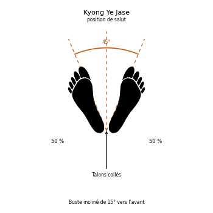

## 16.6 Position parallèle (Narani Sogi)

* **Nomenclature coréenne :** *Narani Sogi / [나란히 서기](../../../audio/grammaire/Narani-Sogi.m4a)*.
* **Largeur :** Les pieds sont écartés d'**une largeur d'épaule** entre les gros orteils.
* **Orientation :** Les pieds sont strictement parallèles, les orteils pointant droit devant (0°).
* **Poids :** Réparti à 50% sur le pied gauche, 50% sur le pied droit.
* **Schéma d'alignement :**

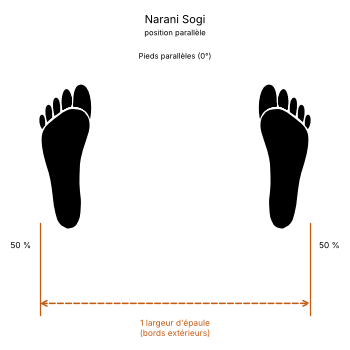

## 16.7 Position d'attente parallèle (Narani Junbi Sogi)

* **Nomenclature coréenne :** *Narani Junbi Sogi / [나란히 준비 서기](../../../audio/grammaire/Narani-Junbi-Sogi.m4a)*.
* **Base :** Identique à la position parallèle (*Narani Sogi*).
* **Posture des bras :** Les deux poings sont placés devant l'abdomen.
* **Distances de contrôle :**
    * Écart entre les deux poings : **5 cm**.
    * Distance entre les poings et l'abdomen : **7 cm**.
* **Schéma d'alignement :**

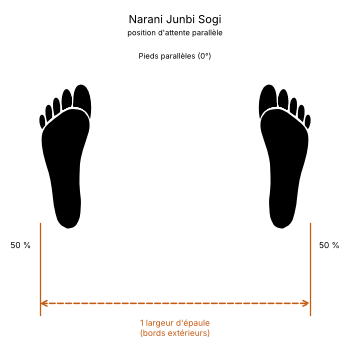

## 16.8 Position assise (Annun Sogi)

* **Nomenclature coréenne :** *Annun Sogi / [앉은 서기](../../../audio/grammaire/Annun-Sogi.m4a)*.
* **Largeur :** **Une largeur et demie d'épaule** mesurée de centre à centre de chaque pied.
* **Orientation :** Les pieds sont strictement parallèles, les orteils pointant vers l'avant (0°).
* **Genoux :** Forcer puissamment les genoux vers l'extérieur.
* **Poids et Posture :** Poids réparti à 50% sur chaque jambe, abdomen contracté et tendu pour assurer une stabilité maximale lors des mouvements latéraux.
* **Schéma d'alignement :**

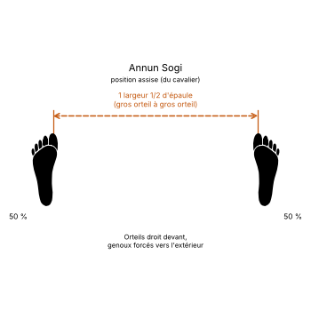

## 16.9 Position de marche (Gunnun Sogi)

* **Nomenclature coréenne :** *Gunnun Sogi / [걷는 서기](../../../audio/grammaire/Gunnun-Sogi.m4a)*.
* **Longueur :** **Une largeur et demie d'épaule** mesurée entre les gros orteils du pied avant et du pied arrière.
* **Largeur :** **Une largeur d'épaule** mesurée de centre à centre de chaque pied.
* **Orientation :**
    * Pied avant : Pointe strictement vers l'avant (0°).
    * Pied arrière : Ouvert à un angle précis de **25 degrés vers l'extérieur**. *Un angle supérieur à 25° affaiblit l'articulation du genou face à une attaque par l'arrière.*
* **Flexion des jambes :**
    * Jambe avant : Fléchie jusqu'à ce que la rotule forme une **ligne droite verticale avec l'arrière du talon**.
    * Jambe arrière : Maintenue complètement droite et tendue.
* **Poids :** Réparti équitablement (50/50).
* **Musculature :** Tendre les muscles des pieds en les sentant tirer l'un vers l'autre pour sceller l'ancrage au sol.
* **Usage :** Position forte vers l'avant comme vers l'arrière.
* **Erreur courante :** Une position plus longue que prévu rend le déplacement lent et fragilise la posture contre une attaque de côté comme contre une attaque de face ou de dos.
* **Schéma d'alignement :**

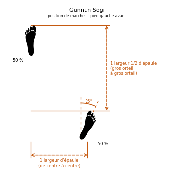

## 16.10 Position en « L » (Niunja Sogi)

* **Nomenclature coréenne :** *Niunja Sogi / [ㄴ자 서기](../../../audio/grammaire/Niunja-Sogi.m4a)*.
* **Longueur :** **Une largeur et demie d'épaule** mesurée entre le gros orteil du pied avant et le petit orteil du pied arrière.
* **Alignement et décalage :** Les pieds forment presque un angle droit (90°). Les orteils de chaque pied pointent à environ **15 degrés vers l'intérieur**. Le talon du pied avant est décalé et placé à environ **2,5 cm en avant** de la ligne du talon du pied arrière pour assurer la stabilité latérale.
* **Poids :** Réparti à **70% sur la jambe arrière** et **30% sur la jambe avant**.
* **Flexion :**
    * Jambe arrière : Fléchie jusqu'à ce que la rotule forme une ligne verticale droite avec les orteils. Conserver la hanche parfaitement alignée avec la jointure interne du genou arrière.
    * Jambe avant : Fléchie en conséquence.
* **Usage :** Posture de garde principalement défensive permettant d'intercepter, bloquer ou contre-attaquer instantanément de la jambe avant sans transfert préalable du centre de gravité.
* **Schéma d'alignement :**

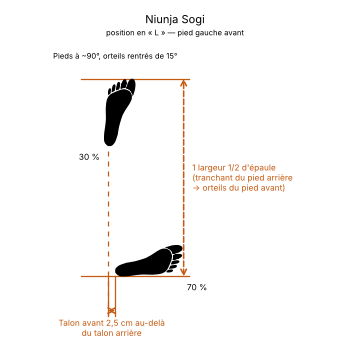

## 16.11 Position fixe (Gojung Sogi)

* **Nomenclature coréenne :** *Gojung Sogi / [고정 서기](../../../audio/grammaire/Gojung-Sogi.m4a)*.
* **Structure :** Identique à la position en L (*Niunja Sogi*), à l'exception de la répartition du poids et de la longueur.
* **Longueur :** **Une largeur et demie d'épaule** mesurée du gros orteil du pied avant au gros orteil du pied arrière.
* **Poids :** Réparti équitablement à **50% sur chaque jambe**.
* **Usage :** Position extrêmement forte et stable pour les attaques et défenses de côté en puissance.
* **Schéma d'alignement :**

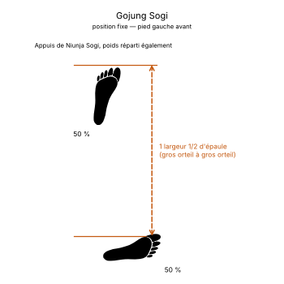

## 16.12 Position sur une jambe (Waebal Sogi)

* **Nomenclature coréenne :** *Waebal Sogi / [외발 서기](../../../audio/grammaire/Waebal-Sogi.m4a)*.
* **Exécution :** Étirer complètement la jambe d'appui immobile au sol. Placer le tranchant externe du pied de la jambe relevée directement **sur la rotule** (ou dans le creux poplité) du genou de support.
* **Poids :** 100% sur la jambe d'appui, 0% sur la jambe pliée.
* **Usage :** Exercices d'équilibre, mais aussi techniques d'attaque et de défense sur un seul appui.
* **Schéma d'alignement :**

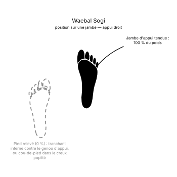

## 16.13 Position fléchie (Guburyo Sogi)

* **Nomenclature coréenne :** *Guburyo Sogi / [구부려 서기](../../../audio/grammaire/Guburyo-Sogi.m4a)*.
* **Structure :** Identique à la position sur une jambe (*Waebal Sogi*), à la seule différence que la jambe d'appui au sol est **fléchie** pour amortir et stocker l'énergie cinétique.
* **Usage :** Posture de préparation dynamique avant de délivrer un coup de pied de côté (*Yop Chagi*) ou vers l'arrière (*Dwit Chagi*), et parfois posture de défense.
* **Schéma d'alignement :**

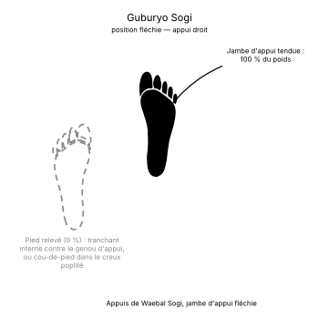

## 16.14 Position en « X » (Kyocha Sogi)

* **Nomenclature coréenne :** *Kyocha Sogi / [교차 서기](../../../audio/grammaire/Kyocha-Sogi.m4a)*.
* **Exécution :** Croiser un pied devant ou derrière l'autre.
* **Appuis :** Le pied de soutien (immobile) est posé à plat au sol et supporte **l'intégralité du poids du corps (100%)**. Le pied croisé touche le sol très légèrement uniquement avec **la plante du pied (les orteils)** pour servir de stabilisateur directionnel.
* **Usage :** Position de transition très fluide et propice aux attaques de face ou de côté en déplacement.
* **Schéma d'alignement :**

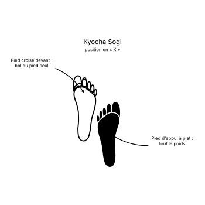

## 16.15 Position arrière rapprochée (Dwitbal Sogi)

* **Nomenclature coréenne :** *Dwitbal Sogi / [뒷발 서기](../../../audio/grammaire/Dwitbal-Sogi.m4a)*.
* **Longueur :** Écartement très court d'**une largeur d'épaule** mesurée entre les deux petits orteils.
* **Alignement :** Les genoux sont fléchis. Le talon du pied arrière est positionné en ligne droite verticale directement derrière le talon du pied avant.
* **Orientation :**
    * Pied arrière : À plat au sol. Les orteils pointent vers l'intérieur à **35 degrés**, et le genou arrière doit impérativement **pointer légèrement vers l'intérieur**.
    * Pied avant : Talon décollé du sol, le pied ne fait que **frôler le sol avec la plante**. Les orteils pointent vers l'intérieur à **25 degrés**.
* **Poids :** Presque 100% sur la jambe arrière fléchie (le pied avant restant libre pour frapper instantanément ou ajuster la distance).
* **Schéma d'alignement :**

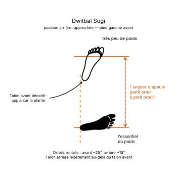

## 16.16 Position basse (Nachuo Sogi)

* **Nomenclature coréenne :** *Nachuo Sogi / [낮추어 서기](../../../audio/grammaire/Nachuo-Sogi.m4a)*.
* **Structure :** Identique à la position de marche (*Gunnun Sogi*), à la seule différence qu'elle est **plus longue d'une longueur de pied**.
* **Poids :** Réparti à 50% sur la jambe avant, 50% sur la jambe arrière.
* **Usage :** Allonger la portée des armes corporelles d'attaque et renforcer la musculature des cuisses.
* **Schéma d'alignement :**

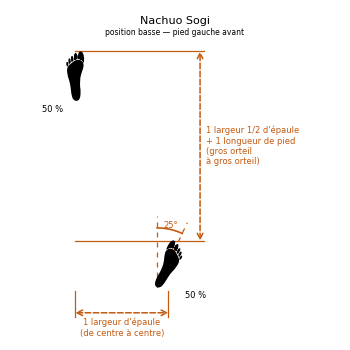

## 16.17 Position rapprochée (Moa Sogi)

* **Nomenclature coréenne :** *Moa Sogi / [모아 서기](../../../audio/grammaire/Moa-Sogi.m4a)*.
* **Exécution :** Se tenir simplement debout, les **pieds entièrement collés** l'un contre l'autre (bords internes des talons et des gros orteils en contact).
* **Poids :** Réparti équitablement (50/50).
* **Schéma d'alignement :**

## 16.18 Position verticale (Soojik Sogi)

* **Nomenclature coréenne :** *Soojik Sogi / [수직 서기](../../../audio/grammaire/Soojik-Sogi.m4a)*.
* **Longueur :** Écartement d'**une largeur d'épaule** mesurée entre les deux gros orteils.
* **Orientation :** Comme en position en L, les pieds forment presque un angle droit, et les orteils des **deux pieds** pointent à environ **15 degrés vers l'intérieur**.
* **Jambes :** Les deux jambes sont maintenues **parfaitement droites et tendues** (sans aucune flexion des genoux).
* **Poids :** Réparti à **60% sur la jambe arrière** et **40% sur la jambe avant**.
* **Schéma d'alignement :**

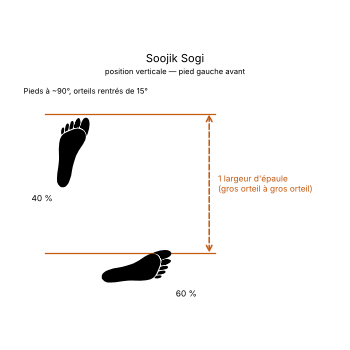

## 16.19 Position en diagonale (Sasun Sogi)

* **Nomenclature coréenne :** *Sasun Sogi / [사선 서기](../../../audio/grammaire/Sasun-Sogi.m4a)*.
* **Structure :** Reprend les dimensions de la position assise (*Annun Sogi*), mais avec un décalage longitudinal.
* **Décalage :** Le **talon du pied avant est placé sur la même ligne horizontale que les orteils du pied arrière**.
* **Usage :** Très utile pour basculer instantanément vers la position de marche (*Gunnun Sogi*) sans avoir à déplacer les appuis au sol.
* **Schéma d'alignement :**

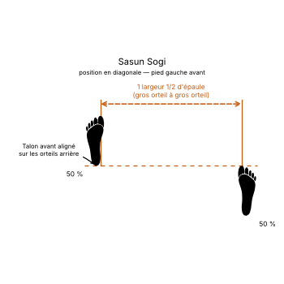

## 16.20 Position accroupie (Oguryo Sogi)

* **Nomenclature coréenne :** *Oguryo Sogi / [오구려 서기](../../../audio/grammaire/Oguryo-Sogi.m4a)*.
* **Structure :** Il s'agit d'une variante de la position en diagonale (*Sasun Sogi*).
* **Flexion :** Les deux genoux sont fléchis et **forcés vers l'intérieur** l'un vers l'autre pour créer une tension dynamique active dans les cuisses.
* **Dimensions :** L'écartement entre les pieds peut être ajusté librement selon les besoins tactiques.
* **Schéma d'alignement :**

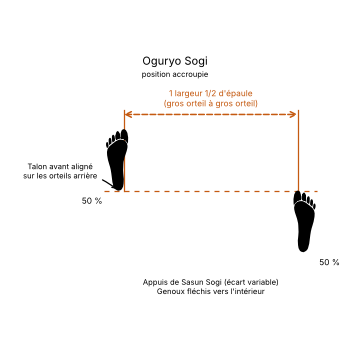

## 16.21 Positions ouvertes (Palja Sogi)

* **Nomenclature coréenne :** *Palja Sogi / [팔자 서기](../../../audio/grammaire/Palja-Sogi.m4a)*.
* **Usage :** Postures d'attente peu stables utilisées pour le relâchement ou la relaxation des membres.
* **Variantes :**
    * **Ouverte à l'intérieur (An Palja Sogi) :** Les pieds sont écartés d'une largeur d'épaule et les **orteils pointent vers l'intérieur** l'un de l'autre.
    * **Ouverte à l'extérieur (Bakat Palja Sogi) :** Les pieds sont écartés d'une largeur d'épaule et les **orteils pointent vers l'extérieur à un angle de 45 degrés**.
* **Schémas d'alignement :**

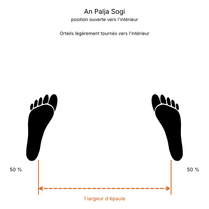

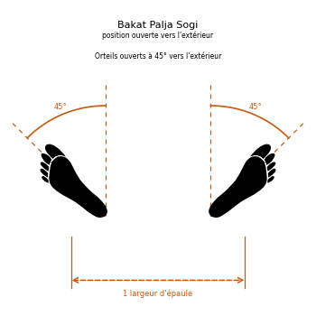
