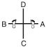
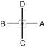

# 22. Les exercices fondamentaux (Saju)

Bien que ne faisant pas partie des 24 formes officielles, ces exercices à quatre directions constituent le socle technique indispensable pour l'initiation des novices (10e Gup).

## Saju Jirugi (Quatre directions - Attaque)

* **Mouvements :** 14 (7 de chaque côté).
* **Diagramme :** Croix ($+$).
* **Signification :** Premier contact avec l'orientation spatiale. Enseigne l'alignement de la position de marche (*Gunnun Sogi*) et la mécanique de frappe rectiligne en piston (*Kaunde Jirugi*).
* **Contexte socio-technique :** Conçu pour donner une confiance immédiate au débutant en isolant l'attaque de base d'un environnement de combat complexe.

> Exécution mouvement par mouvement : [../tul/saju-jirugi.md](../../../tul/saju-jirugi.md).

## Saju Makgi (Quatre directions - Blocage)

* **Mouvements :** 16 (8 de chaque côté).
* **Diagramme :** Croix ($+$).
* **Signification :** Initiation à l'art de la défense. Enseigne le blocage bas avec le tranchant de la main (*Sonkal Najunde Makgi*) et le blocage moyen de l'avant-bras intérieur (*An Palmok Kaunde Makgi*).
* **Contexte socio-technique :** Établit la notion de protection et de préservation de soi, pilier moral du Taekwon-Do où la défense précède toujours l'attaque.

> Exécution mouvement par mouvement : [../tul/saju-makgi.md](../../../tul/saju-makgi.md).

## Saju Tulgi (Quatre directions - Pique de coude)

* **Mouvements :** 8 (4 de chaque côté).
* **Diagramme :** Croix ($+$).
* **Signification :** Enseigne la position en L (*Niunja Sogi*) et la frappe de coude latérale (*Yop Palkup Tulgi*).
* **Contexte socio-technique :** Transition vers la garde de défense serrée, typique des situations d'autodéfense rapprochée en milieu urbain confiné.

> Exécution mouvement par mouvement : [../tul/saju-tulgi.md](../../../tul/saju-tulgi.md).
