# 24. Les formes une à une

Pour chaque forme : le nombre de mouvements, le tracé au sol, la signification
du nom, et le contexte historique ou politique dont elle est issue.

## 24.1 Chon-Ji (10e Gup à 9e Gup)

* **Mouvements :** 19.
* **Diagramme :** Croix ($+$) représentant le Ciel et la Terre, et l'assemblage des quatre forces cosmiques : la terre, l'eau, le feu et le ciel.
* **Signification :** Littéralement « Le Ciel et la Terre ». En Orient, cela symbolise la création du monde et le commencement de l'histoire humaine, ce qui explique pourquoi cette forme est attribuée à l'adepte novice.
* **Structure symbolique :** Le Tul est divisé en deux parties symétriques : la première (mouvements 1 à 8) représente le Ciel (blocages bas et coups de poing en position de marche) ; la seconde (mouvements 9 à 19) représente la Terre (blocages moyens en position en L et frappes en position de marche).
* **Contexte socio-politique :** Représente l'état originel de paix et de pureté d'esprit recherché par l'adepte, imperméable aux corruptions de la société matérialiste moderne.

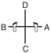

> Exécution mouvement par mouvement : [../tul/chon-ji.md](../../../tul/chon-ji.md).

## 24.2 Dan-Gun (9e Gup à 8e Gup)

* **Mouvements :** 21.
* **Diagramme :** La lettre capitale $I$ (représentant le concept de « l'étudiant » ou de l'ancrage fondateur).
* **Signification :** Nommé en l'honneur du saint **Dan-Gun**, fondateur mythique de la Corée en l'an 2333 avant J.-C..
* **Contexte historique et politique :** Dan-Gun unit les tribus nomades de la péninsule pour fonder le royaume antique de **Gojoseon** (Chosun). Le Général Choi utilise cette figure historique pour enraciner le Taekwon-Do dans l'identité nationale coréenne, affirmant l'autonomie et l'antiquité culturelle de la Corée face aux tentatives historiques d'assimilation chinoise et japonaise.

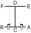

> Exécution mouvement par mouvement : [../tul/dan-gun.md](../../../tul/dan-gun.md).

## 24.3 Do-San (8e Gup à 7e Gup)

* **Mouvements :** 24.
* **Diagramme :** Une marche d'escalier en zigzag (symbolisant la « voie » ou l'ascension par l'éducation).
* **Signification :** Pseudonyme du grand patriote et éducateur **Ahn Chang-Ho** (1878-1938). Les 24 mouvements représentent l'intégralité de sa vie qu'il a consacrée à l'avancement de l'éducation en Corée et au mouvement d'indépendance nationale.
* **Contexte socio-politique :** Ahn Chang-Ho a lutté activement contre l'occupation coloniale japonaise (1910-1945) par la fondation d'écoles indépendantes (*Shinminhoe*). Son combat n'était pas seulement militaire, mais profondément social et économique, considérant que l'indépendance de la Corée passait par l'éducation de la jeunesse et le réarmement moral de la population.

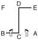

> Exécution mouvement par mouvement : [../tul/do-san.md](../../../tul/do-san.md).

## 24.4 Won-Hyo (7e Gup à 6e Gup)

* **Mouvements :** 28.
* **Diagramme :** La lettre capitale $I$ (symbole de l'étudiant).
* **Signification :** Nommé en l'honneur du moine bouddhiste **Won-Hyo** (617-686 apr. J.-C.), qui introduisit et popularisa le bouddhisme sous la dynastie de Silla.
* **Contexte religieux et philosophique :** Won-Hyo vécut sous le règne de Silla, à une époque d'intenses guerres intestines entre les trois royaumes (Silla, Koguryo, Baekje). Contrairement aux moines de l'époque qui s'isolaient dans les monastères de l'aristocratie, Won-Hyo parcourut les campagnes pour enseigner le bouddhisme au peuple démuni, unifiant spirituellement la nation brisée par la misère économique et la guerre.

> Exécution mouvement par mouvement : [../tul/won-hyo.md](../../../tul/won-hyo.md).

## 24.5 Yul-Gok (6e Gup à 5e Gup)

* **Mouvements :** 38.
* **Diagramme :** Le caractère chinois représentant l'« Érudit » / le « Lettré ».
* **Signification :** Pseudonyme du grand philosophe, écrivain et politicien **Yi I** (1536-1584), surnommé le « Confucius de la Corée ». Les 38 mouvements font référence à sa ville natale située sur le 38e degré de latitude (qui deviendra plus tard la ligne de démarcation politique de la Corée divisée).
* **Contexte socio-politique :** Yi I vécut sous la dynastie Joseon (Yi). Esprit visionnaire, il tenta de réformer l'économie nationale et proposa d'entraîner une armée de 100 000 soldats pour défendre le pays contre l'invasion imminente des samouraïs japonais de Toyotomi Hideyoshi. Ses propositions furent rejetées par une cour rongée par les querelles de factions politiques égoïstes, menant la Corée à la catastrophe lors de la guerre d'Imjin (1592).

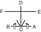

> Exécution mouvement par mouvement : [../tul/yul-gok.md](../../../tul/yul-gok.md).

## 24.6 Joong-Gun (5e Gup à 4e Gup)

* **Mouvements :** 32.
* **Diagramme :** La lettre capitale $I$.
* **Signification :** Nommé d'après le célèbre patriote **Ahn Joong-Gun**. Les 32 mouvements rappellent l'âge auquel il fut exécuté à la prison impériale de Lui-Shung en 1910.
* **Contexte politique d'oppression :** Le 26 octobre 1909, Ahn Joong-Gun assassina **Hirobumi Ito**, le premier gouverneur général japonais de la Corée et principal artisan du traité de protectorat forcé de 1905, qui dépouilla économiquement et politiquement la Corée de sa souveraineté. M. Ahn accomplit cet acte non par vengeance, mais au nom de la justice internationale et de la paix en Asie de l'Est.

> Exécution mouvement par mouvement : [../tul/joong-gun.md](../../../tul/joong-gun.md).

## 24.7 Toi-Gye (4e Gup à 3e Gup)

* **Mouvements :** 37.
* **Diagramme :** Le caractère de l'« Érudit » / le « Lettré ».
* **Signification :** Pseudonyme du grand érudit **Yi Hwang** (1501-1570), une autorité mondiale incontournable du néo-confucianisme. Les 37 mouvements de la forme font référence à son lieu de naissance situé au 37e degré de latitude.
* **Contexte philosophique et éthique :** Yi Hwang a consacré sa vie à l'étude des classiques confucéens, établissant l'éthique de la culture morale et de l'auto-discipline comme piliers du service public. Il a fondé l'académie privée de *Dosan Seowon* pour enseigner l'humilité et la recherche de la vérité, fuyant le luxe et l'arrogance de la cour politique de Séoul pour préserver l'intégrité de sa pensée.

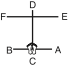

> Exécution mouvement par mouvement : [../tul/toi-gye.md](../../../tul/toi-gye.md).

## 24.8 Hwa-Rang (3e Gup à 2e Gup)

* **Mouvements :** 29.
* **Diagramme :** La lettre capitale $I$ (symbole de l'étudiant).
* **Signification :** Nommé d'après le groupe de jeunes guerriers d'élite **Hwa-Rang** (littéralement « Fleur de la jeunesse »), originaire du royaume de Silla au début du VIIe siècle. Les 29 mouvements font référence à la **29e division d'infanterie** de l'armée de la Corée du Sud, au sein de laquelle le Général Choi développa et amena le Taekwon-Do à maturité technique.
* **Contexte de chevalerie militaire :** Les Hwa-Rangs s'entraînaient à escalader les montagnes et nager dans les eaux glacées tout en respectant un code de conduite en 5 points dicté par le moine Won Kang (loyauté envers le roi, obéissance aux parents, honneur envers les amis, bravoure au combat, et justice dans l'usage de la force). Ce code spirituel et moral a transformé des techniques de combat primitives en un art martial noble et structuré.

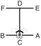

> Exécution mouvement par mouvement : [../tul/hwa-rang.md](../../../tul/hwa-rang.md).

## 24.9 Choong-Moo (2e Gup à 1er Gup)

* **Mouvements :** 30.
* **Diagramme :** La lettre capitale $I$.
* **Signification :** Surnom posthume donné au grand amiral **Yi Sun-Sin** de la dynastie Joseon, inventeur en 1592 du *Kobukson* (le célèbre navire-tortue blindé), précurseur du cuirassé moderne.
* **Asymétrie symbolique :** La forme se termine par une attaque de la main gauche pour symboliser la mort tragique et prématurée de l'amiral lors de la bataille de Noryang (1598), sans qu'il ait pu démontrer son plein potentiel en raison de la jalousie politique de son roi qui l'avait injustement emprisonné.
* **Contexte socio-militaire :** Face à l'invasion navale japonaise dévastatrice, l'amiral Yi Sun-Sin sauva la dynastie Joseon d'une annihilation complète par son génie tactique et sa loyauté indéfectible, luttant avec un budget économique inexistant et des ressources navales infimes contre une flotte ennemie écrasante.

---

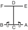

> Exécution mouvement par mouvement : [../tul/choong-moo.md](../../../tul/choong-moo.md).

## 24.10 Kwang-Gae (1er Dan)

* **Mouvements :** 39.
* **Diagramme :** Le caractère chinois symbolisant la reconquête et l'expansion territoriale.
* **Signification :** En l'honneur de **Kwang-Gae-Toh-Wang**, le 19e roi de la dynastie Koguryo, qui reconquit tous les territoires perdus de la Mandchourie. Les 39 mouvements correspondent aux deux premiers chiffres de l'an 391 apr. J.-C., l'année de son couronnement.
* **Contexte géopolitique de souveraineté :** Sous son règne, le royaume de Koguryo connut son apogée économique et militaire, s'affirmant comme une superpuissance asiatique capable de rivaliser avec l'empire chinois. Le tracé de la forme symbolise la reconquête territoriale et la fierté d'une nation forte face aux agressions extérieures.

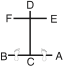

> Exécution mouvement par mouvement : [../tul/kwang-gae.md](../../../tul/kwang-gae.md).

## 24.11 Po-Eun (1er Dan)

* **Mouvements :** 36.
* **Diagramme :** Une ligne horizontale droite ($-$) représentant la loyauté indéfectible.
* **Signification :** Pseudonyme du poète et pionnier de la physique **Chong Mong-Chu** (1337-1392). Son poème patriotique (« *Je ne servirais pas d'autre maître même si l'on me crucifierait cent fois* ») est gravé dans la mémoire de tous les Coréens.
* **Contexte de transition politique :** Chong Mong-Chu resta loyal à la dynastie de Koryo en déclin, s'opposant au général Yi Sung-Gae qui allait usurper le trône pour fonder la dynastie Joseon. Il fut assassiné sur le pont Seonjuk par les partisans de la nouvelle faction politique. Son tracé sur une seule ligne droite symbolise sa fidélité inflexible.

> Exécution mouvement par mouvement : [../tul/po-eun.md](../../../tul/po-eun.md).

## 24.12 Ge-Baek (1er Dan)

* **Mouvements :** 44.
* **Diagramme :** Une ligne verticale unique (symbolisant la sévérité et l'intégrité de sa discipline militaire).
* **Signification :** Nommé en l'honneur du légendaire général **Ge-Baek** du royaume de Baekje (660 apr. J.-C.).
* **Contexte tragique et militaire :** En 660, le royaume de Baekje fut envahi par une coalition écrasante de 50 000 soldats de Silla alliés à 130 000 troupes de la dynastie chinoise des Tang. Conscient de l'issue fatale de la bataille, le général Ge-Baek préféra tuer sa propre famille pour lui éviter l'esclavage et le viol par les vainqueurs avant de charger héroïquement à la tête de ses 5 000 guerriers lors de la bataille de Hwangsanbeol, illustrant la rigueur d'un code moral militaire poussé jusqu'au sacrifice suprême.

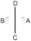

> Exécution mouvement par mouvement : [../tul/ge-baek.md](../../../tul/ge-baek.md).

## 24.13 Eui-Am (2e Dan)

* **Mouvements :** 45.
* **Diagramme :** Une ligne verticale unique (démontrant un esprit indomptable).
* **Signification :** Pseudonyme de **Son Byong-Hi**, chef spirituel et leader du mouvement d'indépendance de la Corée du 1er mars 1919. Les 45 mouvements rappellent l'âge auquel il substitua au terme de *DongHak* (culture orientale) celui de *Chondo Kyo* (religion de la voie céleste) en 1905.
* **Contexte d'éveil social et d'insurrection :** Son Byong-Hi fut l'un des 33 signataires de la déclaration d'indépendance de 1919. Il utilisa la force pacifique et l'organisation spirituelle de la religion *Chondo Kyo* pour mobiliser des millions de paysans coréens contre la spoliation foncière et l'oppression policière brutale de l'impérialisme japonais, prônant le réarmement moral face aux fusils.

> Exécution mouvement par mouvement : [../tul/eui-am.md](../../../tul/eui-am.md).

## 24.14 Choong-Jang (2e Dan)

* **Mouvements :** 52.
* **Diagramme :** La lettre capitale $I$.
* **Signification :** Pseudonyme du général **Kim Duk-Ryang** (1567-1596) de la dynastie Joseon.
* **Asymétrie symbolique :** Le dernier mouvement est une attaque de la main gauche pour souligner sa mort tragique et injuste en prison à l'âge de 27 ans, avant même d'avoir pu exprimer son plein potentiel militaire.
* **Contexte politique d'injustice :** Leader d'une armée de volontaires patriotiques contre les invasions japonaises, il fut victime de fausses accusations de trahison politique montées de toutes pièces par des rivaux jaloux au sein de la cour Joseon. Son martyre symbolise la tragédie d'un esprit juste brisé par la paranoïa et la corruption des élites au pouvoir.

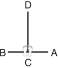

> Exécution mouvement par mouvement : [../tul/choong-jang.md](../../../tul/choong-jang.md).

## 24.15 Juche (2e Dan)

* **Mouvements :** 45.
* **Diagramme :** Le contour du mont sacré **Baekdu**, symbole de la force du peuple coréen.
* **Signification :** Idée philosophique selon laquelle l'homme est le maître de tout et décide de son propre destin.
* **Contexte socio-philosophique :** Conçu à l'origine sous le nom de *Ko-Dang* (en l'honneur de Cho Man-Shik), ce Tul fut renommé *Juche* par le Général Choi pour exprimer l'esprit d'indépendance nationale totale et de souveraineté de la Corée face à l'influence culturelle et politique des grandes puissances mondiales (États-Unis, URSS, Chine).

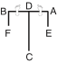

> Exécution mouvement par mouvement : [../tul/juche.md](../../../tul/juche.md).

## 24.16 Sam-Il (3e Dan)

* **Mouvements :** 33.
* **Diagramme :** Une croix ($+$) représentant le soulèvement national ou le lettré.
* **Signification :** Désigne la date historique du **1er mars 1919** (Sam-Il, 3-1), jour où débuta le mouvement indépendantiste pacifique à travers toute la Corée occupée. Les 33 mouvements honorent les **33 patriotes chrétiens, bouddhistes et chondoistes** qui ont rédigé la déclaration d'indépendance nationale.
* **Contexte d'insurrection populaire :** Le mouvement du 1er mars fut une protestation de masse pacifique contre la domination impériale japonaise. Près de 2 millions de Coréens participèrent aux manifestations. La répression japonaise fut sanglante (des milliers de morts, des villages entiers brûlés). Cette date fondatrice de la Corée moderne incarne l'esprit indomptable d'un peuple uni pour sa liberté.

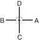

> Exécution mouvement par mouvement : [../tul/sam-il.md](../../../tul/sam-il.md).

## 24.17 Yoo-Sin (3e Dan)

* **Mouvements :** 68.
* **Diagramme :** Le caractère chinois de l'« Érudit ».
* **Signification :** Nommé en l'honneur du célèbre général **Kim Yoo-Sin** (595-673 apr. J.-C.), commandant en chef des armées du royaume de Silla qui unifia la Corée. Les 68 mouvements font référence à l'année de l'unification de la péninsule (668 apr. J.-C.).
* **Symbole de la posture de départ (Le sabre dégainé à droite) :** La posture simule le geste de dégainer un sabre du côté droit plutôt que gauche, symbolisant l'erreur tragique de Yoo-Sin d'avoir obéi aux ordres de son roi d'allier des forces chinoises étrangères (la dynastie Tang) pour combattre ses propres frères de sang des royaumes de Baekje et Koguryo, menant à une souveraineté coréenne amputée au profit de la Chine.

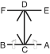

> Exécution mouvement par mouvement : [../tul/yoo-sin.md](../../../tul/yoo-sin.md).

## 24.18 Choi-Yong (3e Dan)

* **Mouvements :** 46.
* **Diagramme :** La lettre capitale $I$.
* **Signification :** Nommé d'après le général **Choi Yong**, premier ministre et commandant en chef des forces armées du royaume de Koryo au XIVe siècle.
* **Contexte de coup d'État politique :** Hautement respecté pour sa loyauté absolue et sa profonde humilité, il fut exécuté par son subordonné direct, le général Yi Sung-Gae, qui usurpa le trône pour fonder la dynastie Joseon en 1392. Sa mort marqua la fin d'une ère d'intégrité et la chute de la dynastie de Koryo.

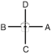

> Exécution mouvement par mouvement : [../tul/choi-yong.md](../../../tul/choi-yong.md).

## 24.19 Yon-Gae (4e Dan)

* **Mouvements :** 49.
* **Diagramme :** La lettre capitale $I$.
* **Signification :** Nommé d'après le célèbre général de Koguryo, **Yon-Gae-Somun**. Les 49 mouvements représentent l'année 649 apr. J.-C. lorsqu'il écrasa les armées d'invasion de la dynastie Tang, forçant l'empereur chinois de l'époque à battre en retraite après avoir perdu près de 300 000 troupes chinoises à la bataille d'Ansi Sung.
* **Contexte socio-politique :** Représente l'affirmation d'une résistance nationale farouche et le refus catégorique de se soumettre à un empire étranger expansionniste, un message puissant de fierté pour les générations futures.

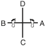

> Exécution mouvement par mouvement : [../tul/yon-gae.md](../../../tul/yon-gae.md).

## 24.20 Ul-Ji (4e Dan)

* **Mouvements :** 42.
* **Diagramme :** Le caractère chinois *乙* (Z inversé), représentant son nom de famille. Les 42 mouvements correspondent à l'âge du Général Choi lorsqu'il créa ce Tul.
* **Signification :** Nommé en l'honneur du général **Ul-Ji Moon-Dok**, qui défendit la Corée contre une invasion chinoise massive de près d'un million d'hommes de la dynastie Sui, menée par l'empereur Yang Je en l'an 612 apr. J.-C..
* **Contexte de stratégie militaire asymétrique :** Grâce à des tactiques d'usure et de harcèlement rapide (guerrière d'usure), le général Ul-Ji Moon-Dok parvint à anéantir les troupes Sui lors de la célèbre bataille de la rivière Salsu, sauvant la Corée d'une colonisation totale.

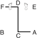

> Exécution mouvement par mouvement : [../tul/ul-ji.md](../../../tul/ul-ji.md).

## 24.21 Moon-Moo (4e Dan)

* **Mouvements :** 61.
* **Diagramme :** Le caractère chinois de l'« Érudit ».
* **Signification :** Nommé en hommage au 30e roi de la dynastie Silla, le roi **Moon-Moo**. Les 61 mouvements rappellent l'année 661 apr. J.-C. lorsqu'il accéda au trône.
* **Contexte socio-politique et sacrifice spirituel :** Suivant sa volonté, son corps fut immergé en mer près du rocher de *DaeWang Am* afin que son âme se réincarne en dragon de mer pour protéger la Corée contre les invasions maritimes japonaises de pirates de l'Est. Sa mémoire incarne le sacrifice suprême de la royauté au service de la paix nationale.

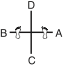

> Exécution mouvement par mouvement : [../tul/moon-moo.md](../../../tul/moon-moo.md).

## 24.22 So-San (5e Dan)

* **Mouvements :** 72.
* **Diagramme :** Le caractère chinois de l'« Érudit ».
* **Signification :** Pseudonyme du grand bonze **Choi Hyong-Ung** (1520-1604) de la dynastie Joseon. Les 72 mouvements font référence à son âge lorsqu'il organisa un corps d'élite de moines-soldats en 1592 pour repousser les forces japonaises qui dévastaient la Corée lors de la guerre d'Imjin.
* **Contexte socio-religieux :** Alors que les moines étaient socialement marginalisés par les élites confucéennes Joseon, So-San et son disciple Sa-Myung Dang prirent les armes par compassion humaine pour sauver la population de la famine et de l'extermination, illustrant l'intégration totale de la force au service de la préservation de la vie.

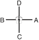

> Exécution mouvement par mouvement : [../tul/so-san.md](../../../tul/so-san.md).

## 24.23 Se-Jong (5e Dan)

* **Mouvements :** 24.
* **Diagramme :** Le caractère chinois représentant le « Roi » (王).
* **Signification :** Nommé en l'honneur du plus grand monarque de l'histoire coréenne, **Se-Jong le Grand**. Les 24 mouvements représentent les 24 lettres de l'alphabet phonétique coréen, le **Hangul**, qu'il inventa en 1443.
* **Contexte de révolution socio-culturelle et économique :** Avant Se-Jong, la population coréenne était analphabète en raison de l'utilisation complexe des caractères chinois, ce qui permettait à l'aristocratie féodale d'abuser du peuple. En créant un alphabet simple de 24 lettres, le roi Se-Jong a démocratisé l'accès au savoir, à l'éducation, et a stimulé le développement agricole et météorologique national.

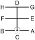

> Exécution mouvement par mouvement : [../tul/se-jong.md](../../../tul/se-jong.md).

## 24.24 Tong-Il (6e Dan)

* **Mouvements :** 56.
* **Diagramme :** Une ligne verticale unique (symbolisant la race coréenne unifiée et homogène).
* **Signification :** Symbolise la résolution et la détermination de réunir à nouveau la Corée divisée en deux nations depuis la partition politique de 1945.
* **Contexte géopolitique moderne :** Tong-Il est le Tul le plus haut de l'école Chang-Hun. Il incarne l'aspiration suprême de paix, d'unité fraternelle et le deuil spirituel d'une nation scindée en deux par les tensions idéologiques de la Guerre Froide. Il appelle chaque pratiquant à œuvrer activement pour la justice internationale et l'unification pacifique des peuples.

> Exécution mouvement par mouvement : [../tul/tong-il.md](../../../tul/tong-il.md).
