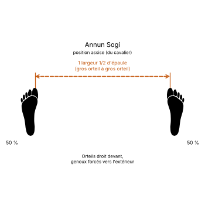

# Annun Junbi Sogi

> 🔊 **Prononciation :** [앉은 준비 서기](../audio/sogi/Annun-Junbi-Sogi.m4a)

Le **Annun Junbi Sogi** ([앉은 준비 서기](../audio/sogi/Annun-Junbi-Sogi.m4a)) est la **position d'attente assise** (*Sitting Ready Stance*) en TaeKwon-Do ITF.

C'est la position assise ([Annun Sogi](Annun-Sogi.md)) avec les mains placées comme en position d'attente de marche ([Gunnun Junbi Sogi](Gunnun-Junbi-Sogi.md)). Elle sert surtout aux exercices de pas de côté.

---

## 1. Caractéristiques techniques et géométrie (*Jook Bang*)

| Caractéristique | Norme technique ITF |
| --- | --- |
| **Pieds** | Ceux de la position assise : une largeur et demie d'épaule, pieds parallèles, genoux poussés vers l'extérieur. |
| **Poings** | Fermés, tenus bas de chaque côté du corps, à environ **30 cm** des cuisses. |
| **Coudes** | Fléchis à environ **30°**. |
| **Répartition du poids** | **50 % / 50 %**. |

---

## 2. Décomposition de l'exécution

1. **Les pieds :** prendre une position assise.
2. **Les poings :** les fermer et les écarter des cuisses d'environ 30 cm.
3. **Les coudes :** les fléchir d'environ 30°.
4. **La posture :** buste droit, abdomen tendu, regard dans la direction de l'exercice.

---

## 3. Utilisation

L'Encyclopédie l'emploie comme point de départ d'exercices fondamentaux de coups de pied et de pas de côté.

---

## 4. Erreurs fréquentes à éviter

* **Genoux rentrés** : ils doivent rester poussés vers l'extérieur, comme en position assise.
* **Poings collés aux cuisses.**

> **Source :** Encyclopédie condensée (1999), p. 80 ; exercices fondamentaux, p. 425 et suivantes.

<!-- fiches-liees : bloc produit par scripts/generer-voir-aussi.py -->

## Fiches liées

* **Dans le Manuel :** [16. Les 27 positions en détail](../Theorie/manuel/partie-4-positions-sogi/16-les-21-positions-en-detail.md)

<!-- /fiches-liees -->
