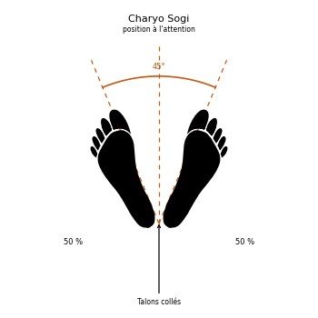

# Charyo Sogi

> 🔊 **Prononciation :** [차렷 서기](../audio/sogi/Charyo-Sogi.m4a)

Le **Charyo Sogi** ([차렷 서기](../audio/grammaire/Charyo-Sogi.m4a)) est la **position à l'attention** (*Attention Stance*) en TaeKwon-Do ITF.

C'est la position du garde-à-vous, prise avant et après chaque exercice, et au début comme à la fin du cours. L'Encyclopédie l'appelle *Charyot Sogi* ; le commandement *Charyot* ([차렷](../audio/lexique/Charyot.m4a)) la fait prendre.

---

## 1. Caractéristiques techniques et géométrie (*Jook Bang*)

| Caractéristique | Norme technique ITF |
| --- | --- |
| **Pieds** | Talons joints, pieds ouverts en un angle de **45°**. |
| **Bras** | Laissés tomber naturellement, **coudes légèrement fléchis**. |
| **Poings** | **Légèrement** serrés. |
| **Regard** | Droit devant, un peu au-dessus de l'horizontale. |

---

## 2. Décomposition de l'exécution

1. **Les pieds :** joindre les talons et ouvrir les pieds à 45°.
2. **Les bras :** les laisser descendre le long du corps, coudes légèrement fléchis.
3. **Les poings :** les fermer sans crispation.
4. **Le regard :** droit devant, légèrement au-dessus de l'horizontale.

---

## 3. Position à l'attention et salut

Le salut ([Kyong Ye Jase](Kyong-Ye-Jase.md)) se fait depuis la position à l'attention. Au commandement *Swiyo* ([쉬어](../audio/grammaire/Swiyo.m4a), repos), l'élève passe en position d'attente parallèle ([Narani Junbi Sogi](Narani-Junbi-Sogi.md)).

---

## 4. Erreurs fréquentes à éviter

* **Bras raides et coudes verrouillés.**
* **Poings serrés trop fort** ou, au contraire, mains ouvertes.
* **Épaules crispées.**
* **Regard baissé.**

> **Source :** Encyclopédie condensée (1999), p. 79 (et p. 415 pour les commandements).

<!-- fiches-liees : bloc produit par scripts/generer-voir-aussi.py -->

## Fiches liées

* **Dans le Manuel :** [16. Les 27 positions en détail](../Theorie/manuel/partie-4-positions-sogi/16-les-21-positions-en-detail.md)

<!-- /fiches-liees -->
