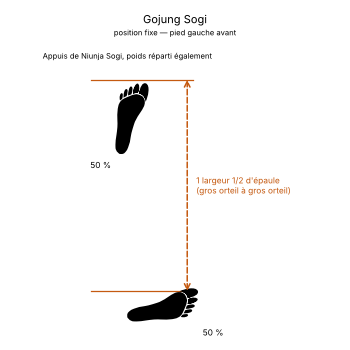

# Gojung Sogi

> 🔊 **Prononciation :** [고정 서기](../audio/grammaire/Gojung-Sogi.m4a)

Le **Gojung Sogi** ([고정 서기](../audio/grammaire/Gojung-Sogi.m4a)) est la **position fixe** (*Fixed Stance*) en TaeKwon-Do ITF.

C'est une variante de la position en L (*Niunja Sogi*) dans laquelle le poids est réparti également sur les deux jambes. Elle est plus longue et plus stable que la position en L, et sert surtout aux attaques et aux défenses vers le côté.

---

## 1. Caractéristiques techniques et géométrie (*Jook Bang*)

| Caractéristique | Norme technique ITF |
| --- | --- |
| **Placement des pieds** | Comme en position en L : les pieds forment presque un angle droit, les orteils des deux pieds tournés d'environ **15° vers l'intérieur**, le talon avant dépassant légèrement le talon arrière. |
| **Longueur** | **Une largeur d'épaules et demie**, mesurée entre les gros orteils des deux pieds. |
| **Répartition du poids** | **50 % / 50 %**, également sur les deux jambes (contre 70 / 30 en position en L). |
| **Position des genoux** | Les deux genoux sont fléchis, sans excès, et ne rentrent pas vers l'intérieur. |
| **Orientation du buste** | Toujours **de trois quarts** (*Hanmom*), en attaque comme en défense. |

---

## 2. Décomposition de l'exécution

1. **Le placement en L :** Placer les pieds comme pour la position en L, les deux pieds presque à angle droit, orteils légèrement rentrés.
2. **L'allongement :** Porter l'écart entre les gros orteils à une largeur d'épaules et demie.
3. **L'équilibrage du poids :** Ramener le centre de gravité au milieu des deux pieds, pour un appui égal sur chaque jambe.
4. **La fixation :** Fléchir les deux genoux et gainer le bassin au moment de l'impact, buste de trois quarts.

---

## 3. Position gauche ou droite

* **Position fixe droite :** le **pied droit** est en avant.
* **Position fixe gauche :** le **pied gauche** est en avant.

---

## 4. Intérêt tactique et application dans les formes (*Tul*)

> **Stabilité latérale et puissance :**
>
> 1. **Attaque et défense de côté :** L'appui égal sur les deux jambes donne une base très stable pour frapper ou bloquer vers le côté, par exemple le coup de poing latéral (*Kaunde Yop Jirugi*) ou le coude latéral (*Yop Palkup Tulgi*).
> 2. **Présence dans les formes :** On la trouve notamment dans **Won-Hyo**, **Joong-Gun**, **Hwa-Rang**, **Choong-Moo**, **Sam-Il**, **Yoo-Sin**, **Choi-Yong** et **Se-Jong**.

---

## 5. Erreurs fréquentes à éviter

* **Orteils tournés vers l'extérieur :** ouvrir les pieds au lieu de les rentrer légèrement fragilise les genoux et la stabilité.
* **Genoux rentrés vers l'intérieur :** les genoux qui se ferment l'un vers l'autre affaiblissent l'appui.
* **Genoux trop fléchis :** une flexion excessive écrase la position et ralentit le déplacement suivant.
* **Poids sur la jambe arrière :** garder 70 % du poids à l'arrière revient à une position en L, pas à une position fixe.

<!-- fiches-liees : bloc produit par scripts/generer-voir-aussi.py -->

## Fiches liées

* **Techniques dans cette position :** 8 fiches, classées dans [Techniques](../Techniques/README.md)

<!-- /fiches-liees -->
