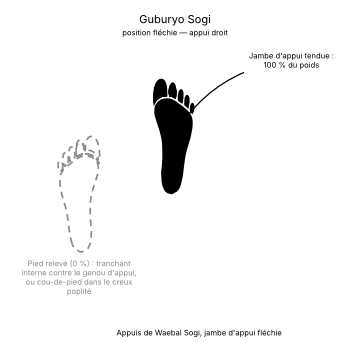

# Guburyo Sogi

Le **Guburyo Sogi** (구부려 서기) est la **position fléchie** (*Bending Stance*) en TaeKwon-Do ITF.

C'est une position sur une jambe dont la jambe d'appui est fléchie. Elle prépare surtout les coups de pied de côté et vers l'arrière, mais sert aussi souvent pour défendre.

---

## 1. Caractéristiques techniques et géométrie (*Jook Bang*)

| Caractéristique | Norme technique ITF |
| --- | --- |
| **Base** | Celle de la position sur une jambe ([Waebal Sogi](Waebal-Sogi.md)), jambe d'appui **fléchie**. |
| **Répartition du poids** | **100 %** sur la jambe d'appui. |
| **Jambe levée** | Pied relevé contre la jambe d'appui, prêt à frapper. |
| **Côté** | **Droite** quand on se tient sur le pied droit, **gauche** dans le cas inverse. |
| **Orientation du buste** | **De face** (*Ohnmom*) ou **de semi-profil** (*Banmom*). |

---

## 2. Décomposition de l'exécution

1. **L'appui :** porter tout le poids sur une jambe et la fléchir.
2. **La jambe levée :** relever l'autre pied contre la jambe d'appui.
3. **L'équilibre :** garder le buste droit au-dessus du pied d'appui.
4. **La préparation :** orienter le pied levé vers la cible du coup de pied à venir.

---

## 3. Position fléchie et position d'attente fléchie

* **Guburyo Sogi :** la position elle-même, d'où partent les coups de pied de côté et vers l'arrière.
* **Guburyo Junbi Sogi :** la même position avec une garde des bras particulière, en deux types : [type A](Guburyo-Junbi-Sogi-A.md) (avant un coup de pied de côté) et [type B](Guburyo-Junbi-Sogi-B.md) (avant un coup de pied vers l'arrière).

---

## 4. Erreurs fréquentes à éviter

* **Tendre la jambe d'appui :** la position devient une position sur une jambe et perd son ressort.
* **Pencher le buste** pour compenser un manque d'équilibre.

> **Source :** Encyclopédie condensée (1999), p. 76.

<!-- fiches-liees : bloc produit par scripts/generer-voir-aussi.py -->

## Fiches liées

* **Dans le Manuel :** [16. Les 27 positions en détail](../Theorie/manuel/partie-4-positions-sogi/16-les-21-positions-en-detail.md)

<!-- /fiches-liees -->
