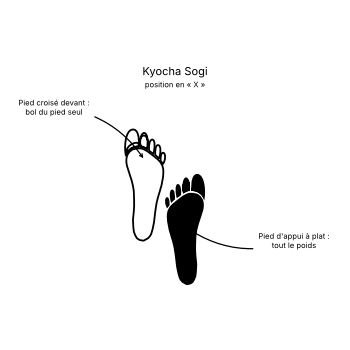

# Kyocha Junbi Sogi

Le **Kyocha Junbi Sogi** (교차 준비 서기) est la **position d'attente en « X »** (*X-Ready Stance*) en TaeKwon-Do ITF.

C'est la position en « X » ([Kyocha Sogi](Kyocha-Sogi.md)) prise comme position d'attente, les bras écartés vers le bas. L'Encyclopédie ne la décrit que par des photos.

---

## 1. Caractéristiques techniques et géométrie (*Jook Bang*)

| Caractéristique | Norme technique ITF |
| --- | --- |
| **Pieds** | Ceux de la position en « X » : un pied croisé devant ou derrière l'autre. |
| **Bras** | Presque tendus, écartés vers le bas de chaque côté du corps (d'après les photos). |
| **Poings** | Fermés. |

---

## 2. Décomposition de l'exécution

1. **Les pieds :** croiser un pied devant ou derrière l'autre.
2. **Les bras :** les écarter vers le bas de chaque côté, presque tendus, poings fermés.
3. **La posture :** buste droit, regard droit devant.

---

## 3. Utilisation

L'Encyclopédie l'emploie comme point de départ de certains exercices fondamentaux en position assise, comme la frappe latérale du tranchant de la main en position assise.

---

## 4. Erreurs fréquentes à éviter

* **Bras collés au corps** : ils sont écartés.
* **Perdre l'équilibre** en croisant les pieds trop loin.

> **Source :** Encyclopédie condensée (1999), p. 83 ; exercices fondamentaux, p. 434.

<!-- fiches-liees : bloc produit par scripts/generer-voir-aussi.py -->

## Fiches liées

* **Dans le Manuel :** [16. Les 27 positions en détail](../Theorie/manuel/partie-4-positions-sogi/16-les-21-positions-en-detail.md)

<!-- /fiches-liees -->
