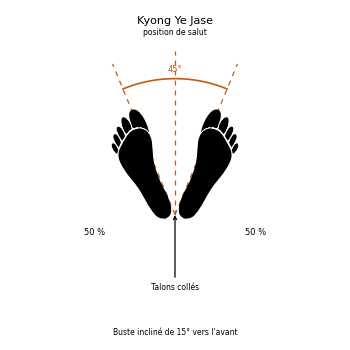

# Kyong Ye Jase

> 🔊 **Prononciation :** [경례 자세](../audio/sogi/Kyong-Ye-Jase.m4a)

Le **Kyong Ye Jase** ([경례 자세](../audio/grammaire/Kyong-Ye-Jase.m4a)) est la **posture de salut** (*Bow Posture*) en TaeKwon-Do ITF.

C'est le salut du TaeKwon-Do ITF : depuis la position à l'attention, le corps s'incline légèrement vers l'avant, sans quitter l'autre des yeux. Il se fait au commandement *Kyong Ye* ([경례](../audio/combats/Kyong-ye.m4a)).

---

## 1. Caractéristiques techniques et géométrie (*Jook Bang*)

| Caractéristique | Norme technique ITF |
| --- | --- |
| **Base** | La position à l'attention ([Charyo Sogi](Charyo-Sogi.md)). |
| **Inclinaison** | Le corps s'incline de **15°** vers l'avant. |
| **Regard** | Fixé dans les yeux de l'autre, pendant tout le salut. |

---

## 2. Décomposition de l'exécution

1. **Le départ :** prendre la position à l'attention.
2. **L'inclinaison :** incliner le corps de 15° vers l'avant, d'un seul bloc.
3. **Le regard :** garder les yeux dans ceux de l'autre.
4. **Le retour :** revenir à la position à l'attention.

---

## 3. Dans le cours

Le salut ouvre et ferme le cours : au commandement *Kyong Ye*, l'élève salue l'instructeur en restant à l'attention.

---

## 4. Erreurs fréquentes à éviter

* **S'incliner trop bas**, à la manière d'une révérence.
* **Baisser les yeux** vers le sol.
* **Plier seulement la nuque** au lieu d'incliner le buste.

> **Source :** Encyclopédie condensée (1999), p. 79 (et p. 415 pour le déroulement du cours).

<!-- fiches-liees : bloc produit par scripts/generer-voir-aussi.py -->

## Fiches liées

* **Dans le Manuel :** [16. Les 27 positions en détail](../Theorie/manuel/partie-4-positions-sogi/16-les-21-positions-en-detail.md)

<!-- /fiches-liees -->
