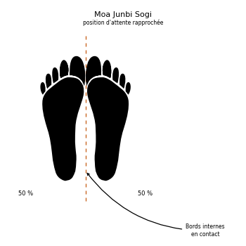

# Moa Junbi Sogi A

> 🔊 **Prononciation :** [모아 준비 서기](../audio/sogi/Moa-Junbi-Sogi-A.m4a)

Le **Moa Junbi Sogi A** ([모아 준비 서기](../audio/lexique/Moa-junbi-sogi.m4a)) est la **position d'attente rapprochée A** (*Close Ready Stance A*) en TaeKwon-Do ITF.

C'est la position rapprochée ([Moa Sogi](Moa-Sogi.md)) avec les mains réunies devant le visage : la main gauche enveloppe le poing droit. C'est une posture de concentration avant la forme.

---

## 1. Caractéristiques techniques et géométrie (*Jook Bang*)

| Caractéristique | Norme technique ITF |
| --- | --- |
| **Pieds** | Joints, comme en position rapprochée. |
| **Mains** | Le poing droit enveloppé par la main gauche, tenus devant le visage. L'Encyclopédie ne précise pas quelle main enveloppe l'autre ; la main gauche sur le poing droit est la pratique retenue ici. |
| **Distance poings-philtrum** | Environ **30 cm**. |
| **Répartition du poids** | **50 % / 50 %**. |

---

## 2. Décomposition de l'exécution

1. **Les pieds :** les joindre.
2. **Les mains :** fermer le poing droit et l'envelopper de la main gauche.
3. **La hauteur :** monter les mains devant le visage, à environ 30 cm du philtrum (le creux sous le nez).
4. **La posture :** épaules basses, regard droit devant par-dessus les mains.

---

## 3. Les quatre types de Moa Junbi Sogi

L'Encyclopédie distingue quatre types, selon la place des mains :

* **A :** poing droit enveloppé par la main gauche, devant le visage, à environ 30 cm du philtrum (voir [type A](Moa-Junbi-Sogi-A.md)).
* **B :** poing droit enveloppé par la main gauche, devant le ventre, à environ 15 cm du nombril (voir [type B](Moa-Junbi-Sogi-B.md)).
* **C :** mains ouvertes, la gauche couvrant en partie la droite, devant le bas-ventre, à environ 10 cm de l'abdomen (voir [type C](Moa-Junbi-Sogi-C.md)).
* **D :** poings tenus bas, à environ 30 cm des cuisses (voir [type D](Moa-Junbi-Sogi-D.md)).

Le type A est la posture de départ de *Won-Hyo*, *Choong-Jang* et *So-San*.

---

## 4. Erreurs fréquentes à éviter

* **Inverser les mains :** c'est la main gauche qui enveloppe le poing droit.
* **Mains trop près du visage**, qui masquent le regard.
* **Mains trop basses**, à hauteur de poitrine : on se rapproche du type B.
* **Épaules montées.**

> **Source :** Encyclopédie condensée (1999), p. 80 ; formes : *Won-Hyo*, *Choong-Jang*, *So-San*.

<!-- fiches-liees : bloc produit par scripts/generer-voir-aussi.py -->

## Fiches liées

* **Dans le Manuel :** [16. Les 27 positions en détail](../Theorie/manuel/partie-4-positions-sogi/16-les-21-positions-en-detail.md)

<!-- /fiches-liees -->
