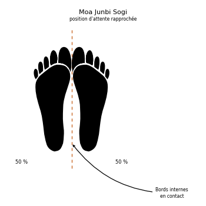

# Moa Junbi Sogi B

> 🔊 **Prononciation :** [모아 준비 서기](../audio/Techniques/Moa-Junbi-Sogi-B.m4a)

Le **Moa Junbi Sogi B** ([모아 준비 서기](../audio/Techniques/Moa-Junbi-Sogi-B.m4a)) est la **position d'attente rapprochée B** (*Close Ready Stance B*) en TaeKwon-Do ITF.

C'est la position rapprochée ([Moa Sogi](Moa-Sogi.md)) avec les mains réunies devant le ventre, un poing enveloppé par l'autre main. C'est une posture de concentration avant la forme.

---

## 1. Caractéristiques techniques et géométrie (*Jook Bang*)

| Caractéristique | Norme technique ITF |
| --- | --- |
| **Pieds** | Joints, comme en position rapprochée. |
| **Mains** | Un poing enveloppé par l'autre main, tenus devant le ventre (d'après les photos ; le texte ne dit pas quelle main enveloppe l'autre). |
| **Distance poings-nombril** | Environ **15 cm**. |
| **Répartition du poids** | **50 % / 50 %**. |

---

## 2. Décomposition de l'exécution

1. **Les pieds :** les joindre.
2. **Les mains :** fermer un poing et l'envelopper de l'autre main.
3. **La hauteur :** placer les mains devant le ventre, à environ 15 cm du nombril, coudes légèrement fléchis.
4. **La posture :** épaules basses, regard droit devant.

---

## 3. Les quatre types de Moa Junbi Sogi

L'Encyclopédie distingue quatre types, selon la place des mains :

* **A :** poings tenus devant le visage, à environ 30 cm du philtrum (voir [type A](Moa-Junbi-Sogi-A.md)).
* **B :** poings devant le ventre, à environ 15 cm du nombril (voir [type B](Moa-Junbi-Sogi-B.md)).
* **C :** mains ouvertes devant le bas-ventre, à environ 10 cm de l'abdomen (voir [type C](Moa-Junbi-Sogi-C.md)).
* **D :** poings tenus bas, à environ 30 cm des cuisses (voir [type D](Moa-Junbi-Sogi-D.md)).

Le type B est la posture de départ de *Joong-Gun*, *Toi-Gye* et *Se-Jong*.

---

## 4. Erreurs fréquentes à éviter

* **Mains collées au ventre** au lieu d'en être écartées d'environ 15 cm.
* **Mains trop hautes**, devant la poitrine ou le visage : on se rapproche du type A.
* **Épaules crispées.**

> **Source :** Encyclopédie condensée (1999), p. 81 ; formes : *Joong-Gun*, *Toi-Gye*, *Se-Jong*.

<!-- fiches-liees : bloc produit par scripts/generer-voir-aussi.py -->

## Fiches liées

* **Dans le Manuel :** [16. Les 27 positions en détail](../Theorie/manuel/partie-4-positions-sogi/16-les-21-positions-en-detail.md)
* **Dans les formes :** [Kwang-Gae](../tul/kwang-gae.md), [Ul-Ji](../tul/ul-ji.md), [Se-Jong](../tul/se-jong.md)

<!-- /fiches-liees -->
