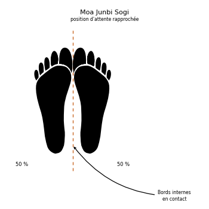

# Moa Junbi Sogi C

> 🔊 **Prononciation :** [모아 준비 서기](../audio/Techniques/Moa-Junbi-Sogi-C.m4a)

Le **Moa Junbi Sogi C** ([모아 준비 서기](../audio/Techniques/Moa-Junbi-Sogi-C.m4a)) est la **position d'attente rapprochée C** (*Close Ready Stance C*) en TaeKwon-Do ITF.

C'est la position rapprochée ([Moa Sogi](Moa-Sogi.md)) avec les deux mains ouvertes, l'une posée sur l'autre, tenues bas devant le bas-ventre. C'est une posture de concentration avant la forme.

---

## 1. Caractéristiques techniques et géométrie (*Jook Bang*)

| Caractéristique | Norme technique ITF |
| --- | --- |
| **Pieds** | Joints, comme en position rapprochée. |
| **Mains** | Ouvertes, l'une posée sur l'autre, devant le bas-ventre (d'après les photos). |
| **Distance mains-abdomen** | Environ **10 cm**. |
| **Répartition du poids** | **50 % / 50 %**. |

---

## 2. Décomposition de l'exécution

1. **Les pieds :** les joindre.
2. **Les mains :** les ouvrir et poser l'une sur l'autre.
3. **La hauteur :** les tenir bas devant le bas-ventre, à environ 10 cm de l'abdomen, bras presque tendus.
4. **La posture :** épaules basses, regard droit devant.

---

## 3. Les quatre types de Moa Junbi Sogi

L'Encyclopédie distingue quatre types, selon la place des mains :

* **A :** poing droit enveloppé par la main gauche, devant le visage, à environ 30 cm du philtrum (voir [type A](Moa-Junbi-Sogi-A.md)).
* **B :** poing droit enveloppé par la main gauche, devant le ventre, à environ 15 cm du nombril (voir [type B](Moa-Junbi-Sogi-B.md)).
* **C :** mains ouvertes devant le bas-ventre, à environ 10 cm de l'abdomen (voir [type C](Moa-Junbi-Sogi-C.md)).
* **D :** poings tenus bas, à environ 30 cm des cuisses (voir [type D](Moa-Junbi-Sogi-D.md)).

Le type C est la posture de départ de *Hwa-Rang*, *Sam-Il* et *Choi-Yong*.

---

## 4. Erreurs fréquentes à éviter

* **Fermer les poings :** en type C, les mains restent ouvertes.
* **Mains collées au corps** au lieu d'en être écartées d'environ 10 cm.

> **Source :** Encyclopédie condensée (1999), p. 81 ; formes : *Hwa-Rang*, *Sam-Il*, *Choi-Yong*.

<!-- fiches-liees : bloc produit par scripts/generer-voir-aussi.py -->

## Fiches liées

* **Dans le Manuel :** [16. Les 27 positions en détail](../Theorie/manuel/partie-4-positions-sogi/16-les-21-positions-en-detail.md)
* **Dans les formes :** [Yoo-Sin](../tul/yoo-sin.md)

<!-- /fiches-liees -->
