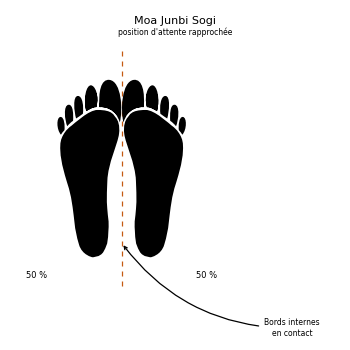

# Moa Junbi Sogi D

> 🔊 **Prononciation :** [모아 준비 서기](../audio/sogi/Moa-Junbi-Sogi-D.m4a)

Le **Moa Junbi Sogi D** ([모아 준비 서기](../audio/lexique/Moa-junbi-sogi.m4a)) est la **position d'attente rapprochée D** (*Close Ready Stance D*) en TaeKwon-Do ITF.

C'est la position rapprochée ([Moa Sogi](Moa-Sogi.md)) avec les poings tenus bas, écartés du corps de part et d'autre.

---

## 1. Caractéristiques techniques et géométrie (*Jook Bang*)

| Caractéristique | Norme technique ITF |
| --- | --- |
| **Pieds** | Joints, comme en position rapprochée. |
| **Mains** | Poings fermés, tenus bas de chaque côté du corps. |
| **Distance poings-cuisses** | Environ **30 cm**. |
| **Répartition du poids** | **50 % / 50 %**. |

---

## 2. Décomposition de l'exécution

1. **Les pieds :** les joindre.
2. **Les poings :** les fermer et les écarter des cuisses d'environ 30 cm, de chaque côté.
3. **Les coudes :** légèrement fléchis, sans raideur.
4. **La posture :** épaules relâchées, regard droit devant.

---

## 3. Les quatre types de Moa Junbi Sogi

L'Encyclopédie distingue quatre types, selon la place des mains :

* **A :** poing droit enveloppé par la main gauche, devant le visage, à environ 30 cm du philtrum (voir [type A](Moa-Junbi-Sogi-A.md)).
* **B :** poing droit enveloppé par la main gauche, devant le ventre, à environ 15 cm du nombril (voir [type B](Moa-Junbi-Sogi-B.md)).
* **C :** mains ouvertes, la gauche couvrant en partie la droite, devant le bas-ventre, à environ 10 cm de l'abdomen (voir [type C](Moa-Junbi-Sogi-C.md)).
* **D :** poings tenus bas, à environ 30 cm des cuisses (voir [type D](Moa-Junbi-Sogi-D.md)).

Le type D est la posture de départ de *Eui-Am*.

---

## 4. Erreurs fréquentes à éviter

* **Bras tendus et raides.**
* **Poings collés aux cuisses** au lieu d'en être écartés d'environ 30 cm.
* **Pieds écartés :** en *Moa*, ils restent joints.

> **Source :** Encyclopédie condensée (1999), p. 81 ; forme : *Eui-Am*.

<!-- fiches-liees : bloc produit par scripts/generer-voir-aussi.py -->

## Fiches liées

* **Dans le Manuel :** [16. Les 27 positions en détail](../Theorie/manuel/partie-4-positions-sogi/16-les-21-positions-en-detail.md)

<!-- /fiches-liees -->
