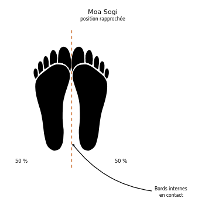

# Moa Sogi

> 🔊 **Prononciation :** [모아 서기](../audio/Techniques/Moa-Sogi.m4a)

Le **Moa Sogi** ([모아 서기](../audio/Techniques/Moa-Sogi.m4a)) est la **posture pieds joints** (*Closed stance*) en TaeKwon-Do ITF.

C'est une posture d'alignement, d'équilibre central et de salutation/rassemblement. Bien qu'elle paraisse simple, elle demande une grande rigueur dans le placement du centre de gravité et est utilisée aussi bien dans les positions de départ (*Junbi Sogi*) que pour exécuter des blocages et frappes spécifiques dans les patrons (*Tul*).

---

## 1. Caractéristiques techniques et géométrie (*Jook Bang*)

| Caractéristique | Norme technique ITF |
| --- | --- |
| **Alignement des pieds** | **Pieds totalement joints et parallèles** : les bords intérieurs des pieds (talons, métatarses et gros orteils) sont en contact direct sur toute la longueur. |
| **Répartition du poids** | **50% / 50%** : le poids du corps est réparti de manière parfaitement équilibrée sur les deux pieds. |
| **Position des jambes** | Les jambes sont tendues sans être hyperextendues, ou légèrement souples selon le type de préparation ou de blocage executé. |
| **Orientation du corps** | Peut s'exécuter de face (*Jungmyeon*), de profil (*Yopmyeon*) ou de semi-profil (*Ban-Jungmyeon*) selon la technique associée. |

---

## 2. Les variantes de Moa Sogi avec les mains (*Junbi Sogi*)

En TaeKwon-Do ITF, la posture *Moa Sogi* sert très souvent de position de départ de préparation (**Junbi Sogi**) pour certains patrons. Selon le placement des mains, elle prend plusieurs noms distincts :

1. **Moa Junbi Sogi A ([모아 준비 서기](../audio/Techniques/Moa-Junbi-Sogi-B.m4a) A) :**
    * **Mains :** La main droite fermée en poing est enveloppée par la main gauche ouverte devant l'abdomen (à environ 10 cm au-dessous du nombril).
    * **Utilisation :** Position de départ de patrons comme **Chon-Ji**, **Dan-Gun**, **Do-San**, etc.
2. **Moa Junbi Sogi B ([모아 준비 서기](../audio/Techniques/Moa-Junbi-Sogi-B.m4a) B) :**
    * **Mains :** Les deux poings sont fermés et placés côte à côte au niveau de la ceinture/du plexus, paumes vers l'intérieur.
    * **Utilisation :** Position de départ de patrons comme **Po-Eun Tul**.
3. **Moa Junbi Sogi C ([모아 준비 서기](../audio/Techniques/Moa-Junbi-Sogi-B.m4a) C) :**
    * **Mains :** Les deux mains ouvertes, paumes vers le haut, sont superposées ou placées juste au-dessous du bas-ventre.
    * **Utilisation :** Position de départ de patrons comme **Gae-Baek Tul**.
4. **Moa Junbi Sogi D ([모아 준비 서기](../audio/Techniques/Moa-Junbi-Sogi-B.m4a) D) :**
    * **Mains :** Les mains sont ouvertes et placées le long des cuisses.

---

## 3. Intérêt tactique et Application dans les patrons (*Tul*)

> **Contrôle de l'axe vertical, symétrie et travail d'équilibre :**
>
> 1. **Défi d'équilibre :** Avoir les pieds collés réduit considérablement la surface de la base de flottaison au sol. Exécuter un blocage (ex: *Moa So An Palmok Yobap Makgi*) ou une frappe depuis *Moa Sogi* exige un contrôle parfait de la sangle abdominale et de la verticale du corps.
> 2. **Rassemblement d'énergie (*Concentration*) :** Cette posture symbolise le rassemblement des forces, le calme avant l'explosion et l'alignement mental.
> 3. **Présence dans les patrons (*Tul*) :** On retrouve des techniques exécutées en posture *Moa Sogi* dans de nombreux patrons ITF (ex: **Eul-Ji Tul**, **Joo-Gye Tul**, **Yoo-Sin Tul**, **Po-Eun Tul**).

---

## 4. Erreurs fréquentes à éviter

* **Écartement des pieds :** Laisser un espace entre les talons ou les pointes de pieds au lieu de coller strictement les bords intérieurs.
* **Pieds en "V" :** Ouvrir les pointes de pieds vers l'extérieur (position de canard) au lieu de maintenir les bords intérieurs parallèles et joints.
* **Bassin cassé / Dos voûté :** Relâcher la posture dorsale ou basculer les fesses vers l'arrière au lieu de maintenir une colonne vertébrale bien droite.
* **Hyper-extension des genoux :** Verrouiller exagérément les rotules vers l'arrière, ce qui nuit à la circulation et à la réactivité.

<!-- fiches-liees : bloc produit par scripts/generer-voir-aussi.py -->

## Fiches liées

* **Techniques dans cette position :** 14 fiches, classées dans [Techniques](../Techniques/README.md)
* **Dans les formes :** [Tong-Il](../tul/tong-il.md)

<!-- /fiches-liees -->
