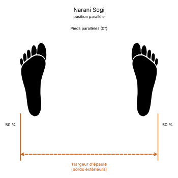

# Moosa Junbi Sogi A

> 🔊 **Prononciation :** [무사 준비 서기](../audio/sogi/Moosa-Junbi-Sogi-A.m4a)

Le **Moosa Junbi Sogi A** ([무사 준비 서기](../audio/sogi/Moosa-Junbi-Sogi-A.m4a)) est la **position d'attente du guerrier A** (*Warrior Ready Stance A*) en TaeKwon-Do ITF.

C'est une position d'attente debout, les deux mains réunies sur le côté gauche de la taille, comme sur la poignée d'un sabre. C'est la posture de départ de *Yon-Gae*.

---

## 1. Caractéristiques techniques et géométrie (*Jook Bang*)

| Caractéristique | Norme technique ITF |
| --- | --- |
| **Pieds** | Écartés et parallèles, comme en position parallèle ([Narani Sogi](Narani-Sogi.md)), d'après les photos de l'Encyclopédie ; le texte ne précise pas leur placement. |
| **Mains** | Réunies sur le côté **gauche** de la taille, un poing enveloppé par l'autre main. |
| **Répartition du poids** | **50 % / 50 %**. |

---

## 2. Décomposition de l'exécution

1. **Les pieds :** prendre une position parallèle.
2. **Les mains :** fermer un poing, l'envelopper de l'autre main et amener les deux mains sur le côté gauche de la taille.
3. **La posture :** buste droit et de face, épaules relâchées, regard droit devant.

---

## 3. Les deux types de Moosa Junbi Sogi

* **[Type A](Moosa-Junbi-Sogi-A.md) :** mains du côté gauche de la taille ; posture de départ de *Yon-Gae*.
* **[Type B](Moosa-Junbi-Sogi-B.md) :** mains du côté droit de la taille ; posture de départ de *Yoo-Sin*.

---

## 4. Erreurs fréquentes à éviter

* **Se tromper de côté :** le côté des mains fait toute la différence entre les types A et B.
* **Tourner le buste** vers les mains : il reste de face.

> **Source :** Encyclopédie condensée (1999), p. 82-83 ; forme : *Yon-Gae*.

<!-- fiches-liees : bloc produit par scripts/generer-voir-aussi.py -->

## Fiches liées

* **Dans le Manuel :** [16. Les 27 positions en détail](../Theorie/manuel/partie-4-positions-sogi/16-les-21-positions-en-detail.md)

<!-- /fiches-liees -->
