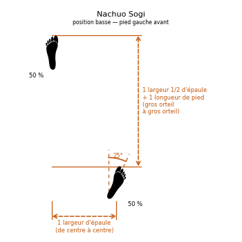

# Nachuo Sogi

> 🔊 **Prononciation :** [낮추어 서기](../audio/grammaire/Nachuo-Sogi.m4a)

Le **Nachuo Sogi** ([낮추어 서기](../audio/grammaire/Nachuo-Sogi.m4a)) est la **position basse** (*Low Stance*) en TaeKwon-Do ITF.

C'est une position de marche (*Gunnun Sogi*) allongée d'une longueur de pied. Plus basse et plus longue, elle allonge la portée de l'arme d'attaque, renforce les muscles des jambes et permet d'ajuster la distance avec la cible.

---

## 1. Caractéristiques techniques et géométrie (*Jook Bang*)

| Caractéristique | Norme technique ITF |
| --- | --- |
| **Longueur** | Celle de la position de marche (**une largeur d'épaules et demie** entre les gros orteils), **plus une longueur de pied**. |
| **Largeur** | **Une largeur d'épaule**, comme en position de marche. |
| **Orientation des pieds** | Comme en position de marche : pied avant droit devant, pied arrière ouvert d'environ **25° vers l'extérieur**. |
| **Répartition du poids** | **50 % / 50 %** sur les deux jambes. |
| **Position des genoux** | Genou avant fléchi au-dessus du pied avant, jambe arrière tendue. |
| **Orientation du buste** | **De face** (*Ohnmom*) ou **de trois quarts** (*Hanmom*). |

---

## 2. Décomposition de l'exécution

1. **La base de marche :** Partir des proportions de la position de marche.
2. **L'allongement :** Reculer le pied arrière, ou avancer le pied avant, d'une longueur de pied supplémentaire, sans changer la largeur.
3. **L'abaissement :** Fléchir davantage le genou avant pour abaisser le bassin, la jambe arrière restant tendue.
4. **Le centrage :** Garder le poids partagé également entre les deux jambes, buste droit.

---

## 3. Position gauche ou droite

* **Position basse droite :** le **pied droit** est en avant.
* **Position basse gauche :** le **pied gauche** est en avant.

---

## 4. Intérêt tactique et application dans les formes (*Tul*)

> **Portée et puissance des jambes :**
>
> 1. **Allonger la portée :** La longueur supplémentaire rapproche l'arme de la cible sans pas de plus, utile pour une pique basse ou une attaque à distance.
> 2. **Régler la distance :** Elle permet de rattraper ou de garder la distance avec l'adversaire.
> 3. **Renforcement :** Tenue correctement, elle développe la force des cuisses.
> 4. **Présence dans les formes :** On la trouve notamment dans **Joong-Gun**, **Kwang-Gae**, **Ge-Baek** et **Choong-Jang**.

---

## 5. Erreurs fréquentes à éviter

* **Simple position de marche :** oublier la longueur de pied supplémentaire.
* **Pieds sur une même ligne :** en allongeant, perdre la largeur d'épaule et donc l'équilibre latéral.
* **Buste penché en avant :** chercher la portée avec le buste au lieu de l'allongement des appuis.
* **Genou arrière fléchi :** la jambe arrière doit rester tendue pour pousser le corps vers l'avant.

<!-- fiches-liees : bloc produit par scripts/generer-voir-aussi.py -->

## Fiches liées

* **Dans le Manuel :** [16. Les 27 positions en détail](../Theorie/manuel/partie-4-positions-sogi/16-les-21-positions-en-detail.md)
* **Techniques dans cette position :** 3 fiches, classées dans [Techniques](../Techniques/README.md)

<!-- /fiches-liees -->
