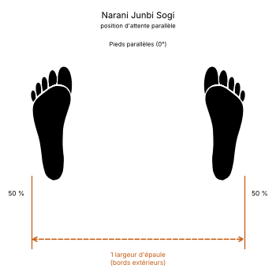

# Narani Junbi Sogi

Le **Narani Junbi Sogi** (나란히 준비 서기) est la **position d'attente parallèle** (*Parallel Ready Stance*) en TaeKwon-Do ITF.

C'est la position parallèle ([Narani Sogi](Narani-Sogi.md)) avec les deux poings ramenés naturellement devant l'abdomen. C'est la position d'attente la plus courante : elle ouvre de nombreuses formes et la plupart des exercices fondamentaux.

---

## 1. Caractéristiques techniques et géométrie (*Jook Bang*)

| Caractéristique | Norme technique ITF |
| --- | --- |
| **Pieds** | Ceux de la position parallèle : **une largeur d'épaule**, pieds parallèles. |
| **Écart entre les poings** | Environ **5 cm**. |
| **Distance poings-abdomen** | Environ **7 cm**. |
| **Distance coudes-côtes flottantes** | Environ **10 cm**. |
| **Bras** | Bras avancés de **30°**, avant-bras relevés de **40°**. |

---

## 2. Décomposition de l'exécution

1. **Les pieds :** prendre une position parallèle.
2. **Les poings :** les fermer et les amener devant l'abdomen, à 5 cm l'un de l'autre et à 7 cm du corps.
3. **Les coudes :** les garder à environ 10 cm des côtes, sans les écarter plus que nécessaire.
4. **La posture :** épaules relâchées, regard droit devant.

---

## 3. Utilisation dans les formes

Posture de départ de nombreuses formes, de *Chon-Ji* à *Tong-Il* : voir la posture de départ de chaque forme dans [les formes](../tul/README.md).

---

## 4. Erreurs fréquentes à éviter

* **Épaules crispées**, signalé par l'Encyclopédie comme l'erreur type.
* **Coudes trop écartés** sur les côtés.
* **Poings collés au ventre** ou trop éloignés.

> **Source :** Encyclopédie condensée (1999), p. 79.

<!-- fiches-liees : bloc produit par scripts/generer-voir-aussi.py -->

## Fiches liées

* **Dans le Manuel :** [16. Les 27 positions en détail](../Theorie/manuel/partie-4-positions-sogi/16-les-21-positions-en-detail.md)

<!-- /fiches-liees -->
