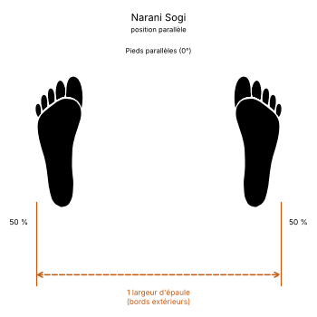

# Narani Sogi

> 🔊 **Prononciation :** [나란히 서기](../audio/grammaire/Narani-Sogi.m4a)

Le **Narani Sogi** ([나란히 서기](../audio/grammaire/Narani-Sogi.m4a)) est la **position parallèle** (*Parallel Stance*) en TaeKwon-Do ITF.

C'est une position debout, jambes droites, pieds écartés d'une largeur d'épaule et parallèles. Elle sert de base à la position d'attente parallèle (*Narani Junbi Sogi*) qui ouvre de nombreuses formes, et s'emploie aussi pour attaquer ou défendre de face ou de côté.

---

## 1. Caractéristiques techniques et géométrie (*Jook Bang*)

| Caractéristique | Norme technique ITF |
| --- | --- |
| **Écartement des pieds** | **Une largeur d'épaule**, mesurée entre les bords extérieurs des pieds. |
| **Orientation des pieds** | **Strictement parallèles**, orteils pointant droit devant (0°). |
| **Répartition du poids** | **50 % / 50 %**, également sur les deux pieds. |
| **Position des genoux** | Jambes droites, genoux souples mais non fléchis. |
| **Orientation du buste** | **De face** (*Ohnmom*) ou **de côté** (*Yopmom*), en attaque comme en défense. |

---

## 2. Décomposition de l'exécution

1. **L'écartement :** Partant pieds joints, écarter un pied sur le côté jusqu'à une largeur d'épaule.
2. **Le parallélisme :** Aligner les deux pieds, orteils droit devant ; ni ouverts, ni rentrés.
3. **Le centrage :** Répartir le poids également sur les deux pieds, le bassin au-dessus du milieu des appuis.
4. **La posture :** Buste droit, épaules relâchées, regard droit devant.

---

## 3. Position parallèle et position d'attente parallèle

* **Narani Sogi :** la position elle-même, dans laquelle on attaque ou on bloque.
* **Narani Junbi Sogi :** la même position des pieds, poings fermés devant l'abdomen ; c'est la position d'attente de début et de fin de nombreuses formes. Elle est décrite au [chapitre 16 du manuel](../Theorie/manuel/partie-4-positions-sogi/16-les-21-positions-en-detail.md).

La position parallèle étant symétrique, elle n'a ni côté gauche ni côté droit.

---

## 4. Intérêt tactique et application dans les formes (*Tul*)

> **Stabilité de face, transition rapide :**
>
> 1. **Attaque et défense de face ou de côté :** coup de poing (*Kaunde Jirugi*), blocage crocheté de la paume (*Sonbadak Golcho Makgi*) ou double frappe du tranchant (*Sang Sonkal Soopyong Taerigi*) s'y exécutent sans changer d'appui.
> 2. **Départ vers les autres positions :** Pieds parallèles et jambes droites, elle permet de passer en un seul pas en position de marche, en L ou assise.
> 3. **Présence dans les formes :** Comme position d'attaque ou de défense, on la trouve notamment dans **Eui-Am**, **Juche**, **Choi-Yong**, **Yon-Gae** et **So-San**.

---

## 5. Erreurs fréquentes à éviter

* **Pieds ouverts en canard :** tourner les orteils vers l'extérieur transforme la position en position ouverte (*Palja Sogi*).
* **Écartement trop grand :** au-delà d'une largeur d'épaule, on glisse vers une position assise mal fléchie.
* **Genoux fléchis :** fléchir les genoux comme en position assise ; la position parallèle se tient jambes droites.
* **Poids sur un pied :** pencher d'un côté rompt l'équilibre de face.

<!-- fiches-liees : bloc produit par scripts/generer-voir-aussi.py -->

## Fiches liées

* **Dans le Manuel :** [16. Les 27 positions en détail](../Theorie/manuel/partie-4-positions-sogi/16-les-21-positions-en-detail.md)
* **Techniques dans cette position :** 9 fiches, classées dans [Techniques](../Techniques/README.md)

<!-- /fiches-liees -->
