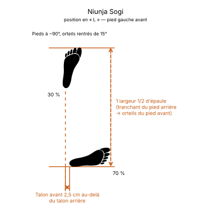

# Niunja Junbi Sogi

Le **Niunja Junbi Sogi** (ㄴ자 준비 서기) est la **position d'attente en « L »** (*L-Ready Stance*) en TaeKwon-Do ITF.

C'est la position en « L » ([Niunja Sogi](Niunja-Sogi.md)) prise comme position d'attente, les poings tenus bas. L'Encyclopédie ne la décrit que par des photos.

---

## 1. Caractéristiques techniques et géométrie (*Jook Bang*)

| Caractéristique | Norme technique ITF |
| --- | --- |
| **Pieds** | Ceux de la position en « L ». |
| **Poings** | Fermés, tenus bas à hauteur de la ceinture, coudes légèrement fléchis (d'après les photos). |
| **Côté** | **Droite** ou **gauche**, comme la position en « L ». |

---

## 2. Décomposition de l'exécution

1. **Les pieds :** prendre une position en « L ».
2. **Les poings :** les fermer et les tenir bas, à hauteur de la ceinture, coudes légèrement fléchis.
3. **La posture :** buste de semi-profil comme en position en « L », regard vers l'avant.

---

## 3. Utilisation

L'Encyclopédie l'emploie comme point de départ des exercices fondamentaux de coups de pied en avançant.

---

## 4. Erreurs fréquentes à éviter

* **Mettre le poids à 50/50** : la répartition reste celle de la position en « L ».
* **Bras raides** ou poings collés au corps.

> **Source :** Encyclopédie condensée (1999), p. 83 ; exercices fondamentaux, p. 429 et suivantes.

<!-- fiches-liees : bloc produit par scripts/generer-voir-aussi.py -->

## Fiches liées

* **Dans le Manuel :** [16. Les 27 positions en détail](../Theorie/manuel/partie-4-positions-sogi/16-les-21-positions-en-detail.md)

<!-- /fiches-liees -->
