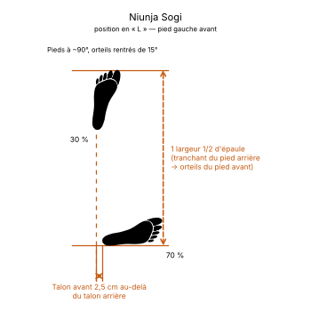

# Niunja Sogi

> 🔊 **Prononciation :** [ㄴ자 서기](../audio/Techniques/Niunja-Sogi.m4a)

La **Niunja Sogi** ([ㄴ자 서기](../audio/Techniques/Niunja-Sogi.m4a)) est la posture en L du Taekwon-Do (ITF). C'est l'une des positions les plus fréquemment utilisées, particulièrement adaptée à la défense, au contre-combat et au travail de garde.

Elle se traduit par : **Position en L** (*L-Stance*).

---

## 1. Décomposition de la terminologie coréenne

| Terme | Hangeul | Traduction | Rôle dans la technique |
| --- | --- | --- | --- |
| **Niunja** | [ㄴ자](../audio/termes/niunja.m4a) | Lettre « [ㄴ](../audio/termes/nieun.m4a) » (Nieuen) | Fait référence à la forme en « L » dessinée au sol par l'alignement des deux pieds. |
| **Sogi** | [서기](../audio/termes/sogi.m4a) | Position / Posture | Posture générale du corps et ancrage des jambes. |

---

## 2. Exécution et principes biomécaniques

La position en L est conçue pour offrir un excellent compromis entre protection, absorption des chocs et mobilité rapide de la jambe avant :

1. **La répartition du poids :**
    * **70 % du poids du corps** repose sur la jambe arrière.
    * **30 % du poids du corps** repose sur la jambe avant.
2. **La position et l'orientation des pieds :**
    * **Longueur :** Environ **1,5 largeur d'épaules**, mesurée du tranchant du pied arrière aux orteils du pied avant. Les deux pieds forment presque un angle droit.
    * **Largeur :** Le gros orteil du pied avant se place environ **2,5 cm au-delà du talon du pied arrière**, vers l'extérieur, pour une meilleure stabilité.
    * **Pied arrière :** Presque perpendiculaire à la ligne d'attaque, orteils tournés d'environ **15° vers l'intérieur**, pour former la base du « L ».
    * **Pied avant :** Pointe vers l'avant, orteils tournés d'environ **15° vers l'intérieur**.
3. **La flexion des jambes et le buste :**
    * **Jambe arrière :** Le genou arrière est fléchi et pointe légèrement vers l'extérieur, au-dessus des orteils, amortissant la majorité du poids.
    * **Jambe avant :** Le genou avant est également fléchi, souple et prêt à réagir.
    * **Buste :** Le corps est placé à **mi-profil** (*Ban Mom* / *Half-facing*), présentant un angle réduit à l'adversaire pour diminuer les zones d'impact vulnérables.

---

## 3. Applications et avantages martiaux

* **Garde défensive solide :** Grâce aux 70 % de poids sur la jambe arrière, l'exécutant peut absorber les coups ou reculer sans être facilement déséquilibré vers l'avant.
* **Départ de coup de pied rapide :** Comme la jambe avant ne porte que 30 % du poids, elle est extrêmement légère. Cela permet de déclencher un coup de pied direct (*Ap Chagi*), circulaire (*Dollyo Chagi*) ou latéral (*Yop Chagi*) sans transfert de masse préalable.
* **Surface d'impact réduite :** La posture à mi-profil protège le plexus solaire et le bas-ventre des attaques directes.
* **Présence dans les Tuls :** C'est une position clé qu'on retrouve dans presque tous les tuls de l'ITF (notamment *Dan-Gun*, *Do-San*, *Won-Hyo*, etc.).

---

## 4. Erreurs fréquentes à éviter

* **Mauvaise répartition du poids :** Répartir le poids à 50/50, ce qui la transforme en position fixe (*Gojung Sogi*) et alourdit la jambe avant.
* **Jambe arrière tendue :** Ne pas fléchir le genou arrière, ce qui monte le centre de gravité et détruit la stabilité.
* **Placer le buste de face (*Full-facing*) :** Orienter les épaules directement vers l'adversaire, ce qui expose tout le thorax et contredit le principe de la garde à mi-profil.
* **Alignement incorrect des pieds :** Écarter trop les pieds en largeur (comme une position en marche) au lieu de maintenir les talons sur la même ligne de référence.
* **Pied arrière trop ouvert :** Pointer le pied arrière complètement vers l'arrière (à 180°), ce qui fragilise la cheville et le genou arrière lors des impacts.

> **Point clé :** La force de la **Niunja Sogi** réside dans son ratio **70/30** : la jambe arrière sert d'ancrage et d'amortisseur, tandis que la jambe avant reste libre de contrer ou d'avancer à tout moment.

<!-- fiches-liees : bloc produit par scripts/generer-voir-aussi.py -->

## Fiches liées

* **Dans le Manuel :** [16. Les 21 positions en détail](../Theorie/manuel/partie-4-positions-sogi/16-les-21-positions-en-detail.md)
* **Techniques dans cette position :** 55 fiches, classées dans [Techniques](../Techniques/README.md)

<!-- /fiches-liees -->
