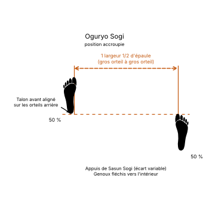

# Oguryo Sogi

Le **Oguryo Sogi** (오구려 서기) est la **position accroupie** (*Crouched Stance*) en TaeKwon-Do ITF.

C'est une variante de la position en diagonale ([Sasun Sogi](Sasun-Sogi.md)) : les genoux sont fléchis et rentrés l'un vers l'autre, ce qui met les jambes sous tension. Elle permet de passer vite à une autre position et offre une garde souple qui pousse l'adversaire à bouger en combat libre. Elle reste peu employée, car les genoux rentrés sont vulnérables aux attaques latérales.

---

## 1. Caractéristiques techniques et géométrie (*Jook Bang*)

| Caractéristique | Norme technique ITF |
| --- | --- |
| **Base** | Celle de la position en diagonale : le talon du pied avant sur la ligne des orteils du pied arrière. |
| **Écartement des pieds** | **Libre**, selon les besoins. |
| **Genoux** | Fléchis et **rentrés vers l'intérieur**, pour tendre les jambes. |
| **Côté** | **Droite** quand le pied droit est devant, **gauche** dans le cas inverse. |
| **Orientation du buste** | **De face** (*Ohnmom*) ou **de côté** (*Yopmom*), en attaque comme en défense. |

---

## 2. Décomposition de l'exécution

1. **Les appuis :** prendre une position en diagonale, le talon avant sur la ligne des orteils du pied arrière.
2. **La flexion :** fléchir les deux genoux.
3. **La tension :** rentrer les genoux l'un vers l'autre pour mettre les cuisses sous tension.
4. **La posture :** buste droit, regard sur l'adversaire.

---

## 3. Avantages et limites

* **Avantage :** les jambes sous tension permettent de changer de position très vite.
* **Limite :** les genoux rentrés exposent l'articulation aux attaques venant des côtés ; c'est pourquoi la position est peu répandue.

---

## 4. Erreurs fréquentes à éviter

* **Laisser les genoux ouverts :** sans les genoux rentrés, ce n'est qu'une position en diagonale fléchie.
* **Pencher le buste en avant** en fléchissant les jambes.

> **Source :** Encyclopédie condensée (1999), p. 74.

<!-- fiches-liees : bloc produit par scripts/generer-voir-aussi.py -->

## Fiches liées

* **Dans le Manuel :** [16. Les 27 positions en détail](../Theorie/manuel/partie-4-positions-sogi/16-les-21-positions-en-detail.md)

<!-- /fiches-liees -->
