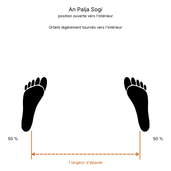
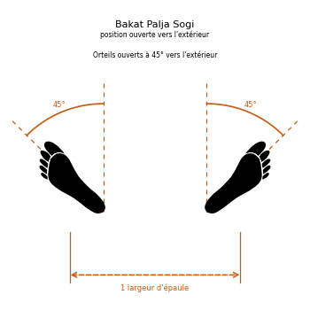

# Palja Junbi Sogi

> 🔊 **Prononciation :** [팔자 준비 서기](../audio/sogi/Palja-Junbi-Sogi.m4a)

Le **Palja Junbi Sogi** ([팔자 준비 서기](../audio/sogi/Palja-Junbi-Sogi.m4a)) est la **position d'attente ouverte** (*Open Ready Stance*) en TaeKwon-Do ITF.

C'est la position ouverte ([Palja Sogi](Palja-Sogi.md)), vers l'intérieur ou vers l'extérieur, avec les deux poings ramenés naturellement au-dessus des cuisses. Elle est rarement employée, parce qu'elle relâche le corps et les muscles.

---

## 1. Caractéristiques techniques et géométrie (*Jook Bang*)

| Caractéristique | Norme technique ITF |
| --- | --- |
| **Pieds** | Ceux de la position ouverte : une largeur d'épaule, orteils tournés vers l'intérieur (*An*) ou ouverts à 45° (*Bakat*). |
| **Poings** | Fermés, ramenés naturellement au-dessus des cuisses. |
| **Répartition du poids** | **50 % / 50 %**. |

---

## 2. Décomposition de l'exécution

1. **Les pieds :** prendre une position ouverte, vers l'intérieur ou vers l'extérieur.
2. **Les poings :** les fermer et les laisser au-dessus des cuisses.
3. **La posture :** buste droit, regard droit devant.

---

## 3. Les deux variantes

* **Position d'attente ouverte vers l'intérieur** (*An Palja Junbi Sogi*) : orteils légèrement rentrés.
* **Position d'attente ouverte vers l'extérieur** (*Bakat Palja Junbi Sogi*) : orteils ouverts à 45°.

---

## 4. Erreurs fréquentes à éviter

* **La confondre avec la position d'attente parallèle** ([Narani Junbi Sogi](Narani-Junbi-Sogi.md)) : pieds parallèles et poings devant l'abdomen.

> **Source :** Encyclopédie condensée (1999), p. 80.

<!-- fiches-liees : bloc produit par scripts/generer-voir-aussi.py -->

## Fiches liées

* **Dans le Manuel :** [16. Les 27 positions en détail](../Theorie/manuel/partie-4-positions-sogi/16-les-21-positions-en-detail.md)

<!-- /fiches-liees -->
