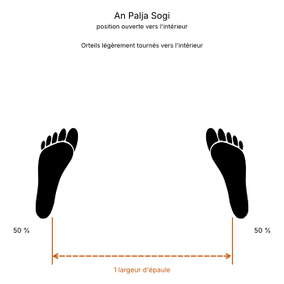
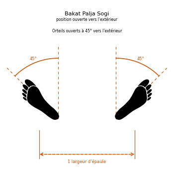

# Palja Sogi

Le **Palja Sogi** (팔자 서기) est la **position ouverte** (*Open Stance*) en TaeKwon-Do ITF.

C'est une position debout, jambes droites, pieds écartés d'une largeur d'épaule. Elle se divise en deux variantes selon l'orientation des orteils : vers l'intérieur (*An Palja Sogi*, 안 팔자 서기) ou vers l'extérieur (*Bakat Palja Sogi*, 밖 팔자 서기). Les muscles des jambes y sont relâchés et l'assise peu stable : on l'emploie donc surtout comme position préparatoire, rarement pour attaquer ou défendre.

---

## 1. Caractéristiques techniques et géométrie (*Jook Bang*)

| Caractéristique | Norme technique ITF |
| --- | --- |
| **Écartement des pieds** | **Une largeur d'épaule**. |
| **Orientation des pieds** | **An Palja Sogi :** orteils légèrement tournés vers l'intérieur. **Bakat Palja Sogi :** orteils ouverts d'environ **45°** vers l'extérieur. |
| **Répartition du poids** | **50 % / 50 %**. |
| **Position des genoux** | Jambes droites, sans tension. |
| **Orientation du buste** | **De face** (*Ohnmom*) ou **de côté** (*Yopmom*). |

---

## 2. Décomposition de l'exécution

1. **L'écartement :** partant pieds joints, écarter un pied sur le côté jusqu'à une largeur d'épaule.
2. **L'orientation :** tourner les orteils légèrement vers l'intérieur (*An Palja*) ou à 45° vers l'extérieur (*Bakat Palja*).
3. **Le centrage :** répartir le poids également sur les deux pieds.
4. **La posture :** buste droit, épaules relâchées, regard droit devant.

---

## 3. Position ouverte et position d'attente ouverte

* **Palja Sogi :** la position des pieds seule.
* **[Palja Junbi Sogi](Palja-Junbi-Sogi.md) :** la même position, poings ramenés au-dessus des cuisses.

Avec la position rapprochée ([Moa Sogi](Moa-Sogi.md)) et la position parallèle ([Narani Sogi](Narani-Sogi.md)), elle fait partie des trois positions qui servent surtout de préparation.

---

## 4. Erreurs fréquentes à éviter

* **Confondre avec la position parallèle :** en *Narani Sogi*, les pieds sont parallèles ; en *Palja Sogi*, ils sont tournés.
* **Ouvrir les pieds de plus de 45° :** la position devient instable et fatigue les chevilles.
* **Écarter les pieds de plus d'une largeur d'épaule.**

> **Source :** Encyclopédie condensée (1999), p. 66.

<!-- fiches-liees : bloc produit par scripts/generer-voir-aussi.py -->

## Fiches liées

* **Dans le Manuel :** [16. Les 27 positions en détail](../Theorie/manuel/partie-4-positions-sogi/16-les-21-positions-en-detail.md)

<!-- /fiches-liees -->
