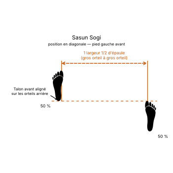

# Sasun Sogi

> 🔊 **Prononciation :** [사선 서기](../audio/grammaire/Sasun-Sogi.m4a)

Le **Sasun Sogi** ([사선 서기](../audio/grammaire/Sasun-Sogi.m4a)) est la **position en diagonale** (*Diagonal Stance*) en TaeKwon-Do ITF.

C'est une position assise (*Annun Sogi*) dont un pied est avancé : le talon du pied avant est sur la même ligne que les orteils du pied arrière. Elle permet de passer en position de marche sans déplacer les pieds.

---

## 1. Caractéristiques techniques et géométrie (*Jook Bang*)

| Caractéristique | Norme technique ITF |
| --- | --- |
| **Écartement des pieds** | **Une largeur d'épaules et demie**, comme en position assise. |
| **Décalage** | Le **talon du pied avant** est sur la même ligne que les **orteils du pied arrière**. |
| **Orientation des pieds** | Comme en position assise : pieds parallèles, orteils droit devant. |
| **Répartition du poids** | **50 % / 50 %** sur les deux jambes. |
| **Position des genoux** | Fléchis et poussés vers l'extérieur, comme en position assise. |
| **Orientation du buste** | **De face** (*Ohnmom*) ou **de côté** (*Yopmom*), en attaque comme en défense. |

---

## 2. Décomposition de l'exécution

1. **La base assise :** Partir des proportions de la position assise.
2. **Le décalage :** Avancer un pied jusqu'à ce que son talon soit à la hauteur des orteils de l'autre pied.
3. **La flexion :** Fléchir les deux genoux vers l'extérieur, le poids partagé également.
4. **La posture :** Buste droit et vertical, bassin gainé.

---

## 3. Position gauche ou droite

* **Position en diagonale droite :** le **pied droit** est en avant.
* **Position en diagonale gauche :** le **pied gauche** est en avant.

---

## 4. Intérêt tactique et application dans les formes (*Tul*)

> **Passer en position de marche sans bouger les pieds :**
>
> 1. **Transition :** Le décalage des pieds correspond déjà à celui d'une position de marche : en pivotant, on y passe sans relocaliser les appuis.
> 2. **Défense vers l'avant ou l'arrière :** Elle s'emploie pour attaquer ou défendre vers l'avant comme vers l'arrière, par exemple avec un coude arrière (*Dwit Palkup Tulgi*) ou un double blocage de la paume (*Sang Sonbadak Noollo Makgi*).
> 3. **Présence dans les formes :** On la trouve notamment dans **Se-Jong**.

---

## 5. Erreurs fréquentes à éviter

* **Décalage trop grand :** avancer le pied au-delà de la ligne des orteils arrière transforme la position en position de marche mal formée.
* **Pas de décalage :** garder les pieds sur la même ligne revient à une position assise.
* **Pieds ouverts :** tourner les orteils vers l'extérieur affaiblit les genoux.
* **Poids sur le pied avant :** la position reste centrée, à parts égales.

---

La position accroupie (*Oguryo Sogi*) en est une variante, genoux rentrés vers l'intérieur ; elle est décrite au [chapitre 16 du manuel](../Theorie/manuel/partie-4-positions-sogi/16-les-21-positions-en-detail.md).

<!-- fiches-liees : bloc produit par scripts/generer-voir-aussi.py -->

## Fiches liées

* **Techniques dans cette position :** 3 fiches, classées dans [Techniques](../Techniques/README.md)

<!-- /fiches-liees -->
