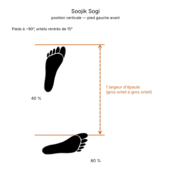

# Soojik Sogi

> 🔊 **Prononciation :** [수직 서기](../audio/grammaire/Soojik-Sogi.m4a)

Le **Soojik Sogi** ([수직 서기](../audio/grammaire/Soojik-Sogi.m4a)) est la **position verticale** (*Vertical Stance*) en TaeKwon-Do ITF.

C'est une position courte, jambes tendues, le poids légèrement porté sur la jambe arrière. Elle s'emploie surtout pour des frappes descendantes du tranchant de la main ou du poing.

---

## 1. Caractéristiques techniques et géométrie (*Jook Bang*)

| Caractéristique | Norme technique ITF |
| --- | --- |
| **Longueur** | **Une largeur d'épaule**, mesurée entre les gros orteils, le pied déplacé vers l'avant ou sur le côté. |
| **Orientation des pieds** | Orteils des **deux pieds** tournés d'environ **15° vers l'intérieur**. |
| **Répartition du poids** | **60 % sur la jambe arrière**, **40 % sur la jambe avant**. |
| **Position des genoux** | Les deux jambes **tendues**. |
| **Orientation du buste** | Toujours **de trois quarts** (*Hanmom*), en attaque comme en défense. |

---

## 2. Décomposition de l'exécution

1. **Le déplacement :** Déplacer un pied vers l'avant ou sur le côté, à une largeur d'épaule entre les gros orteils.
2. **L'orientation :** Rentrer légèrement les orteils des deux pieds, d'environ 15°.
3. **La répartition :** Porter un peu plus de poids sur la jambe arrière (60 %) que sur la jambe avant (40 %).
4. **Le verrouillage :** Tendre les deux jambes, buste de trois quarts.

---

## 3. Position gauche ou droite

Contrairement à la plupart des positions, la position verticale est nommée d'après le **pied arrière** :

* **Position verticale droite :** le **pied droit** est en arrière.
* **Position verticale gauche :** le **pied gauche** est en arrière.

---

## 4. Intérêt tactique et application dans les formes (*Tul*)

> **Frappe descendante et hauteur :**
>
> 1. **Frappes vers le bas :** Jambes tendues et corps haut, elle donne de la hauteur aux frappes descendantes, comme le tranchant de la main (*Sonkal Naeryo Taerigi*) ou le poing latéral (*Yop Joomuk Naeryo Taerigi*).
> 2. **Distance courte :** Plus courte que les autres positions, elle s'emploie quand l'adversaire est proche.

---

## 5. Erreurs fréquentes à éviter

* **Genoux fléchis :** la position verticale se tient jambes tendues.
* **Poids à 50 / 50 ou vers l'avant :** il faut garder 60 % du poids sur la jambe arrière.
* **Orteils ouverts :** les deux pieds sont légèrement rentrés, pas tournés vers l'extérieur.
* **Écart trop long :** au-delà d'une largeur d'épaule, la position perd sa hauteur et sa rapidité.
* **Mauvais côté :** nommer la position d'après le pied avant au lieu du pied arrière.

<!-- fiches-liees : bloc produit par scripts/generer-voir-aussi.py -->

## Fiches liées

* **Techniques dans cette position :** 2 fiches, classées dans [Techniques](../Techniques/README.md)

<!-- /fiches-liees -->
