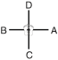

# SAJU TULGI (EXERCICE FONDAMENTAL — QUATRE DIRECTIONS ATTAQUE)

> 🔊 **Prononciation :** [사주 뚫기](../audio/tul/saju-tulgi.m4a)

> **Grade :** 10e Gup — Ceinture blanche

* **Nombre de mouvements :** 8 (Pratiqué à droite et à gauche, soit 4 mouvements par côté)
* **Diagramme au sol :** (Croix / Quatre directions)

| Diagramme | Description |
| --------- | ----------- |
|  | Bien qu'il ne s'agisse pas d'un Tul officiel, Saju Tulgi est un exercice fondamental d'attaque de base pour les débutants, permettant d'apprendre la position en "L" (Niunja Sogi) et le coup de coude latéral. |

## Origine et contexte

* **Contexte socio-technique :** Transition vers la garde de défense serrée, typique des situations d'autodéfense rapprochée en milieu urbain confiné.

## Liste Détaillée des Mouvements

### Posture de départ : **Moa Junbi Sogi C** Position fermée « C » (Close Ready Stance C / Moa Sogi C / [모아 준비 서기](../audio/Techniques/Moa-Junbi-Sogi-B.m4a) C) face à D.

1. Pivoter à 180° vers la gauche, reculer le pied droit en position en L à droite face à C. Bloquer/frapper avec le coude droit latéralement.
**→ ([Orun Niunja So Orun Yop Palkup Tulgi](../Techniques/Niunja-So-Yop-Palkup-Tulgi.md))**
2. Ramener le pied droit contre le pied gauche, pivoter à 90° vers la gauche, reculer le pied droit en position en L à droite face à A. Coup de coude droit latéral.
**→ ([Orun Niunja So Orun Yop Palkup Tulgi](../Techniques/Niunja-So-Yop-Palkup-Tulgi.md))**
3. Ramener le pied droit contre le pied gauche, pivoter à 90° vers la gauche, reculer le pied droit en position en L à droite face à D. Coup de coude droit latéral.
**→ ([Orun Niunja So Orun Yop Palkup Tulgi](../Techniques/Niunja-So-Yop-Palkup-Tulgi.md))**
4. Ramener le pied droit contre le pied gauche, pivoter à 90° vers la gauche, reculer le pied droit en position en L à droite face à B. Coup de coude droit latéral.
**→ ([Orun Niunja So Orun Yop Palkup Tulgi](../Techniques/Niunja-So-Yop-Palkup-Tulgi.md))**
5. Pivoter à 180° vers la droite, reculer le pied gauche en position en L à gauche face à C. Coup de coude gauche latéral.
**→ ([Wen Niunja So Wen Yop Palkup Tulgi](../Techniques/Niunja-So-Yop-Palkup-Tulgi.md))**
6. Ramener le pied gauche contre le pied droit, pivoter à 90° vers la droite, reculer le pied gauche en position en L à gauche face à B. Coup de coude gauche latéral.
**→ ([Wen Niunja So Wen Yop Palkup Tulgi](../Techniques/Niunja-So-Yop-Palkup-Tulgi.md))**
7. Ramener le pied gauche contre le pied droit, pivoter à 90° vers la droite, reculer le pied gauche en position en L à gauche face à D. Coup de coude gauche latéral.
**→ ([Wen Niunja So Wen Yop Palkup Tulgi](../Techniques/Niunja-So-Yop-Palkup-Tulgi.md))**
8. Ramener le pied gauche contre le pied droit, pivoter à 90° vers la droite, reculer le pied gauche en position en L à gauche face à A. Coup de coude gauche latéral.
**→ ([Wen Niunja So Wen Yop Palkup Tulgi](../Techniques/Niunja-So-Yop-Palkup-Tulgi.md))**

### FIN : Ramener le pied gauche contre le pied droit pour revenir à la position de départ face à D. **Moa Junbi Sogi C**.
---

## Synthèse de la décomposition des termes

| Élément | Coréen (Romain) | Hangeul | Signification |
| --- | --- | --- | --- |
| **Position de départ** | *Moa Junbi Sogi C* | [모아 준비 서기](../audio/Techniques/Moa-Junbi-Sogi-B.m4a) C | Posture fermée de préparation C |
| **Côté droit** | *Orun* | [오른](../audio/grammaire/Orun.m4a) | Droit / Droite |
| **Côté gauche** | *Wen* | [왼](../audio/grammaire/Wen.m4a) | Gauche |
| **Posture en L** | *Niunja So* | [ㄴ자 서](../audio/termes/ㄴ자-서.m4a) | Position en L (70 % du poids sur la jambe arrière) |
| **Coup de coude latéral** | *Yop Palkup Tulgi* | [옆 팔꿈치 찌르기](../audio/termes/옆-팔꿈치-찌르기.m4a) | Pique/poussée latérale du coude |
